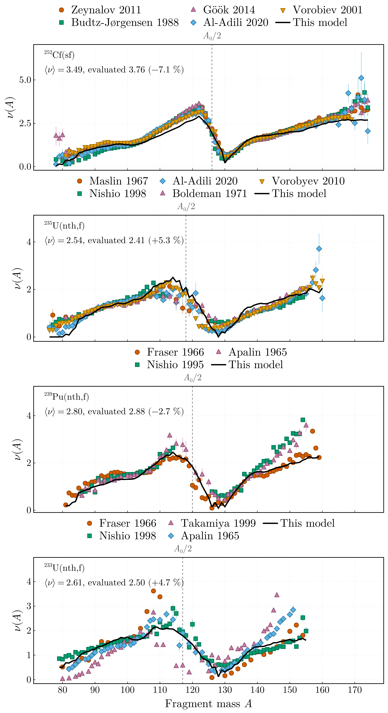
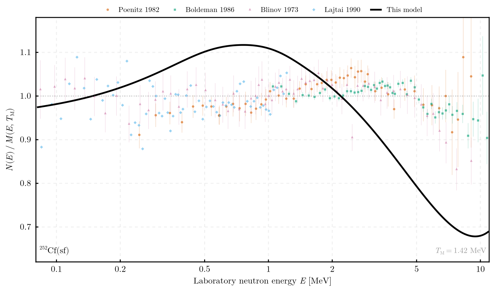

# DeterministicSequentialEmission.jl

Prompt neutron emission from fission fragments, treated sequence by sequence.

## File structure

```
DeterministicSequentialEmission.jl/
├── src/                  library code behind the public interface
├── config/               one TOML per fissioning system, named for it, validated on load
├── scripts/run.jl        entry point: solve a system and write its tables
├── plotting/             CairoMakie environment; redraws figures from those tables
├── test/                 test suite, own environment (Aqua, JET, ExplicitImports)
├── docs/                 Documenter site, own environment
├── data/                 input data — see data/README.md; none of it ships
│   └── sims/             written by a run, data/sims/<system>/<run> — not tracked
├── plots/                the two figures under The model; the diagnostic panels are not tracked
├── formatter/            pinned JuliaFormatter, so the gate cannot drift
├── check.jl              the gate: format, then test
├── activate.jl           activates and instantiates the root environment
└── Project.toml
```

<details>
<summary>Full tree</summary>

```
DeterministicSequentialEmission.jl/
├── src/
│   ├── DeterministicSequentialEmission.jl   the module and its exports
│   ├── partition.jl          TXE partition: scission modelling, E*_H/TXE, R_T
│   ├── evaporation.jl        evaporation cross sections and ⟨ε⟩
│   ├── sequences.jl          the sequential equations and emission chains
│   ├── spectrum.jl           centre-of-mass and laboratory spectra
│   ├── configuration.jl      TOML schema and validation
│   └── pipeline.jl           run_pipeline, write_results, run identifiers
├── config/                   Cf252_sf, U235_nth, U235_nres, U233_nth, Pu239_nth
├── scripts/run.jl            entry point
├── plotting/                 activate.jl, Project.toml, figures.jl
├── test/
│   ├── activate.jl, Project.toml
│   ├── runtests.jl           the suite, then Aqua, ExplicitImports, JET
│   ├── physics.jl            the archived run's configuration and shared helpers
│   ├── test_<module>.jl      one file per source file
│   └── references/Cf252_sf/  pinned tables of the archived run
├── docs/
│   ├── activate.jl, Project.toml, make.jl
│   └── src/                  index, running, naming, system, fragmentation, energetics, emission, observables
├── data/
│   ├── README.md             what each file is and where to obtain it
│   ├── reference/            evaluations that belong to no one system; not tracked
│   ├── <system>/             input data per fissioning system — not tracked
│   └── sims/<system>/<run>/  tables and provenance of a run — not tracked
├── plots/                    multiplicity_vs_experiment and prompt_neutron_spectrum tracked; diagnostics not
├── formatter/                activate.jl, Project.toml — pinned JuliaFormatter
├── .github/dormant/          CI.yml, dependabot.yml, held until the public release
├── .JuliaFormatter.toml
├── .gitattributes
├── activate.jl
├── check.jl
├── CHANGELOG.md
├── CITATION.cff
├── LICENSE
└── Project.toml
```

</details>

## Getting started

```
julia activate.jl                      # root environment
julia test/activate.jl                 # test environment
julia docs/activate.jl                 # documentation environment
julia plotting/activate.jl             # plotting environment
```

Solve one fissioning system:

```
julia scripts/run.jl config/Cf252_sf.toml
```

That writes `data/sims/Cf252_sf/<run>/`: `nu_vs_A.dat`, `T_vs_A.dat`, `E_star_vs_A.dat`, the
residual quantities, the projections against total kinetic energy, the fragment yield
projections, the laboratory spectrum, a table of totals, and the provenance — `metadata.toml`
recording the configuration, the package version, the commit and the platform, beside copies of
the configuration and the resolved `Manifest.toml`. `<run>` is the run identifier,
built from the configuration keys that change the result, so two runs of one system that differ
in any of them land side by side rather than one displacing the other. Nothing is overwritten — a
directory that already holds a run is moved aside with a numbered suffix first.

Redraw the figures from what those runs wrote, without solving anything again:

```
julia plotting/figures.jl
```

That draws the two figures under *The model* from every system a run has written, a panel of
the quantities internal to the emission chain — `E*(A)`, `Ē_r(A)`, `⟨T⟩(A)`, `⟨ε⟩(A)` — and a
diagnostic of the charge distribution each run was weighted by — Wahl's model with the reaction's
own 1988 parameters, for every shipped system — against the alternatives: the 2002 systematics
and the conventional means. Those have no experimental counterpart, so they are diagnostics and are not tracked. Every figure is exported
as PDF and PNG beside a `.toml` sidecar naming, per system, the run drawn, the commit its
metadata records and the measured files, so a panel traces to a configuration and a commit; the
two tracked figures carry their sidecars in the repository.

The charge-distribution diagnostic is worth reading whenever a system is investigated. It shows
where a reaction's own parameters and the systematics part company, which is the uncertainty a
system without a fit of its own inherits. It also shows where a run given a table has fallen off
the end of that table onto the flat fallback.

Run the test suite, and build the documentation:

```
julia check.jl --check
julia docs/make.jl
```

`check.jl --check` verifies the formatting without rewriting anything, then runs the test suite
with its static analysis.

Before committing, apply the gate — format against `.JuliaFormatter.toml` with the
pinned formatter, then run the tests:

```
julia check.jl            # format in place, then test
julia check.jl --check    # report differences without rewriting
```

## Status

| Component | State |
|---|---|
| Package environment, test and docs environments | done |
| Continuous integration, dependency updates, docs deployment | dormant until the public release, under `.github/dormant/` |
| Fragmentation domain, masses, charge distribution, level density, yields | from `FissionFragmentsDomain.jl` 0.2.3 |
| One name per quantity, from configuration key to column header (`docs/src/naming.md`) | done |
| TXE partition — scission modelling, `E*_H/TXE (A_H)`, `R_T (A_H)` | done |
| Sequential equations — constant and variable evaporation cross section | done |
| Prompt fission neutron spectrum — centre-of-mass and laboratory, in closed form | done |
| Configuration, provenance, entry point | done |
| Figures (CairoMakie), redrawn from written tables | done |
| Post-emission distributions | to port |

## The model

Where global treatments integrate an evaporation spectrum over a residual temperature
distribution and return averages, the DSE model solves the energy conservation equation of every
emission sequence separately:

```
Ē_r^(k-1) − S_n^(k-1) − ⟨ε⟩_k = a_k T_k²,    k = 1 … n(A,Z,TKE)
```

with Weisskopf-Ewing evaporation spectra in the centre-of-mass system and fragment level
densities in the Fermi-gas regime. Because the number of sequences `n` is an integer at every
configuration, the post-neutron fragment mass `A_p = A − n` is an integer too, without rounding —
which is what makes the model suitable for independent fission product yields.



The sawtooth is the signature observable, and it is not fitted: the total excitation energy is
shared between the fragments by a temperature ratio `R_T(A_H)` extracted from measured `ν(A)` by
a companion package, the emission chain is then solved configuration by configuration, and the
result is contracted against the measured fragment yield `Y(A, TKE)`. Total multiplicities come
out within −5 % to +5 % of the evaluated values, with no parameter adjusted per system.



The spectrum is the same statement in energy. Model and measurement are both absolute here —
the model spectrum integrates to one neutron by construction, and every retrieved set is
reported against the same 1.42 MeV Maxwellian — so nothing is scaled to anything. Each
fragmentation enters the total by its yield times its multiplicity, so every emitted neutron
counts once, as it does in a measurement. The model is about 4 % soft in `⟨E⟩`, 2.04 MeV
against 2.13: it lies above the data below 1.5 MeV and below them above 2 MeV.

## Configuration

Everything a run needs is in one file. `config/Cf252_sf.toml` is the annotated reference; the
other four are the same file with the system changed. Each is named for the system it declares,
and the test suite asserts that, so a file cannot drift from what it runs. Each key carries its allowed values or its
bounds as a comment, and the loader enforces exactly what the comment says — a configuration
that cannot be honoured fails on load, naming the key.

| System | Configuration | Note |
|---|---|---|
| ²⁵²Cf(sf) | `Cf252_sf.toml` | the archived thesis run's system |
| ²³⁵U(nth,f) | `U235_nth.toml` | |
| ²³⁹Pu(nth,f) | `Pu239_nth.toml` | |
| ²³³U(nth,f) | `U233_nth.toml` | no joint `Y(A,TKE)` exists, so it is reconstructed from two marginals and a borrowed width |
| ²³⁵U(nres,f) at 580 eV | `U235_nres.toml` | the resonance-region beam the GELINA measurements use |

A system is named `<ElementSymbol><A>_<entrance channel>` — the channel as the field spells it, not
as EXFOR codes it — and that one token names the configuration, the input tree under `data/` and
the output tree under `data/sims/`. It is also what separates the thermal run of ²³⁵U from the
resonance one, which the reaction code `n,f` alone cannot.

Every fragment yield comes from EXFOR through ExforFissionData.jl v0.2.4. ²⁵²Cf takes the measured
`Y(A,TKE)` matrix of Göök et al. (2014). For the thermal systems the archive holds no matrix, so
the yield is reconstructed from one experiment's `Y(A)` and `⟨TKE⟩(A)`:
- Al-Adili et al. (2016) for ²³⁵U;
- Wagemans et al. (1984) for ²³⁹Pu;
- Geltenbort (1985) for ²³³U.
None of them reports the width of the kinetic energy distribution, so it is borrowed and flagged:
- Baba et al. (1997), EXFOR 23014003 and 23014002, for the two uranium isotopes;
- for ²³⁹Pu, Schillebeeckx et al. (1992), EXFOR 22273023, measured in spontaneous fission of the
  same compound nucleus, ²⁴⁰Pu. With Wagemans's marginals it reproduces the mass-integrated width
  measured for ²³⁹Pu(nth,f) itself, 11.81 MeV, to 0.02 MeV.

Without any width, `⟨ν⟩` moves by +1.2 % for ²⁵²Cf and +3.9 % for ²³⁵U, measured by running one
experiment's matrix against its own marginals. The spread in TKE smooths the discrete emission
thresholds, which matters most at the low excitation of thermal fission.

The resonance case exists to establish a null result. At 580 eV the compound excitation is
5.8 × 10⁻⁴ MeV above thermal out of 6.5 MeV, and `ν(A)` moves by at most 5 × 10⁻⁴ neutrons, the
total by 10⁻⁷. Below the second-chance fission threshold the model is flat in incident energy, so
a measurement made on a resonance beam is directly comparable with a thermal one. Above that
threshold multiple-chance fission opens, which this model does not treat.

## Input data

Almost none of it is version-controlled: it is third-party scientific data that the licence on
this code does not extend to. `data/README.md` records every file, its format and its source,
and points at the two companion packages that write this layout directly. The 2020 atomic mass
evaluation ships with FissionFragmentsDomain.jl, the domain package this one is built on, so
the tests pinned against the archived reference run execute on a bare clone.
Tests needing anything else announce themselves as skipped rather than passing vacuously.

**Retrieved data is preferred wherever it can be had.** A measurement comes from EXFOR through
`ExforFissionData.jl` if the archive holds it; where the retrieval has no joint `Y(A, TKE)`, the
joint distribution is reconstructed by `factorized_yield` from the two marginals it does hold,
`Y(A)` and `⟨TKE⟩(A)`, which is the route the thermal systems take; a staged table is the last
resort, and no shipped configuration uses one.
`data/README.md` says which systems sit where.

Where several experiments measured the same system, one is taken whole. `Y(A)`, `⟨TKE⟩(A)` and
`σ_TKE(A)` come from that experiment, or its joint matrix does, because they share one energy
calibration, one mass scale, one prompt-neutron correction and one resolution. Marginals are not
spliced across experiments, and curves are not averaged mass by mass. The other experiments serve
as alternative runs. The width `σ_TKE(A)` comes from the same experiment where it reported one;
otherwise it is borrowed from another experiment on the same system, preferring a pre-neutron
width, and flagged. No width is invented. The pre-neutron identities `Y(A) = Y(A₀ − A)`, and
the same for `⟨TKE⟩` and `σ_TKE`, are imposed by averaging the complements
(`[yield] symmetrize = true`, the default). The
run record compares the input yield's mean TKE with the energy standard of Gönnenwein (1991), as
tabulated by Bertsch et al. (2015), doi:10.1088/0954-3899/42/7/077001: 184.1 MeV for ²⁵²Cf(sf);
170.1, 170.5 and 177.9 MeV for thermal ²³³U, ²³⁵U and ²³⁹Pu. A 1 MeV offset moves `⟨ν⟩` by
about 0.08.

The isobaric charge distribution comes from Wahl's `Zₚ` model where no evaluated table is named.
The model, with its parameters, lives in the domain package, which resolves them from the
best-founded source the system reaches:

1. **the reaction's own least-squares parameters**, Wahl (1988), for ²³⁵U(n_th,f), ²³³U(n_th,f),
   ²³⁹Pu(n_th,f) and ²⁵²Cf(sf). The model reproduces that evaluation's own tables row by row.
2. **the systematics**, eq. (17) of LA-13928, for any nucleus in its fitted range;
3. **the conventional means**, `ΔZ = −0.5` and `σ_Z = 0.6` at every mass.

`charge_distribution_file = "wahl"` takes the first that answers, and the run metadata records
which; the shipped configurations use it. An evaluated table named in the configuration outranks all three. EXFOR holds the
independent yields the model is fitted to, but too sparsely per mass to fit a Gaussian at each,
which is why the model exists. Everything here is fitted to spontaneous, thermal and resonance
fission; above roughly 8 MeV multiple-chance fission opens, and the model's separate high-energy
branches would be needed.

## Companion packages

The fragmentation domain — nuclides, masses, charge distribution, level density, energetics,
yields, the temperature-ratio relation and run record — is [`FissionFragmentsDomain.jl`][ffd], a
dependency resolved from its repository. `R_T(A_H)` need not be supplied by hand:
[`FissionTemperatureRatio.jl`][ftr] extracts it from experimental prompt neutron multiplicity data
and tabulates it at every integer `A_H`, and [`ExforFissionData.jl`][exfor] retrieves that data,
and the yields and spectra, from the IAEA EXFOR archive. Neither of those two is a dependency;
this package reads only what they write.

**A temperature-ratio curve is taken through the producing run's own record, never through a path
typed into a configuration.** Copy that run's results directory — its `manifest_<run>.toml` and
the tables beside it — to `data/<system>/temperature_ratio/`, and name it:

```toml
[partition]
method = "temperature_ratio"
subdirectory = "U235_nth/temperature_ratio"
curve_label = "systematic_trend"
```

The shipped configurations read the FissionTemperatureRatio.jl v0.2.1 runs on the
ExforFissionData v0.2.4 multiplicities, staged that way for each system.

The manifest declares what its curves tabulate, and this package refuses one declaring anything
but `R_T` against `A_H`. That is worth the indirection: the run writes `R_T(A_H)` and the
multiplicity ratio `r_ν(A_H)` side by side, in the same column of two files, and `R_T ≈ 1.2` and
`r_ν ≈ 0.5` are both plausible numbers. A curve picked by hand can be the wrong quantity, and the
model will run to completion and report a result nobody can tell is wrong. Reading the record
makes the quantity a matter of record too.

Produce that run with `ratio_averaging = "charge_resolved"`. This partition re-expands `R_T` with
per-`(A_H, Z_H)` level density parameters and reduces over `Z` afterwards, and only the
charge-resolved inversion undoes that exactly; either effective ratio, `⟨a_L⟩/⟨a_H⟩` or
`⟨a_L/a_H⟩`, misses by up to 10⁻² in `R_T`. A run whose manifest records its `[domain]` is checked
against the configuration: a different level density model or Gilbert–Cameron branch, number of
charges per mass, charge model or mass table is refused.

The retrieval records which datasets it kept and which it rejected, with the reason, and that
record is worth reading before using what it wrote. The archive is not uniformly reliable: sets
carrying `DERIV` are derived rather than measured, `SPA` means averaged over a fission spectrum
rather than a thermal one, and a handful of subentries are miscoded and have to be established
as per fragment from the data itself. The comparisons above use only sets that survive those
checks.

[ffd]: https://github.com/PaulGoG/FissionFragmentsDomain.jl
[ftr]: https://github.com/PaulGoG/FissionTemperatureRatio.jl
[exfor]: https://github.com/PaulGoG/ExforFissionData.jl

## Provenance

This branch is a rewrite. The code as submitted with the 2023 MSc thesis, and the thesis itself,
are on the [`original`](../../tree/original) branch. `main` reproduces its physics behind a
tested, configured, documented interface; where it deviates, the deviation is deliberate and
recorded.

The rewrite is pinned against the thesis run archived outside this repository: ²⁵²Cf(SF),
`A_H ∈ [126, 174]`, `TKE = 130:2:230` MeV, 5 charge numbers per `A`, AME2020, variable
evaporation cross section, under both the `E*_H/TXE (A_H)` and `R_T (A_H)` partitions.
`Q(A_H, Z_H)` over all 245 fragmentations, the level density parameter over all 244 where it is
defined, `E*_L` and `E*_H` over 1200 configurations under each partition, 662 and 683 emission
sequences, and the fragment yield projections over 97 masses, 41 charges and 101 kinetic
energies are asserted cell by cell in the test suite.

Beyond the pinned sample, **both archived runs have been reproduced in their entirety**: 9819
and 9788 configurations, and every one of the 44 679 and 45 070 emission sequences they contain,
each quantity to 5 × 10⁻⁹ MeV — exact agreement at the eight decimals the archive was written
with. Both sequence counts match at every configuration. The fragment yield matrix is reproduced
cell for cell, 48 985 of them, and its projections to double precision. The averaged observables
close the chain: `ν(A)`, `T(A)`, `E*(A)` and `E*(TKE)` are reproduced over every mass and kinetic
energy to between 4 × 10⁻¹⁵ and 7 × 10⁻¹⁴, and the total averages to every digit the archive's
summary file prints.

The prompt neutron spectrum has no archived counterpart to pin against, so it is validated
instead against the identities its derivation implies — unit area, `⟨E⟩ = E_f + ⟨ε⟩`, and the
second moment — over the whole domain.

## How to cite

A published result that rests on this package should cite the software, and the measurements
behind its input data as `data/README.md` describes. `CITATION.cff` carries the same entry.

```bibtex
@software{Gogita_DeterministicSequentialEmission_jl,
  author  = {Gogîță, Paul-Adrian},
  title   = {DeterministicSequentialEmission.jl: prompt neutron emission from fission fragments, sequence by sequence},
  year    = {2026},
  url     = {https://github.com/PaulGoG/DeterministicSequentialEmission.jl},
  license = {MIT},
}
```

## Licence

MIT, see `LICENSE`.
