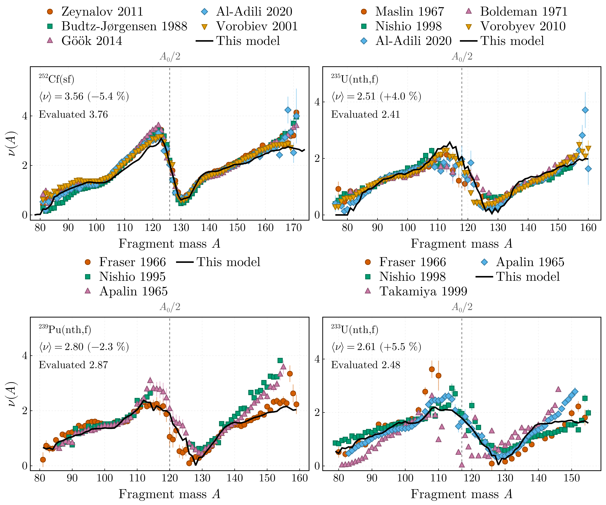
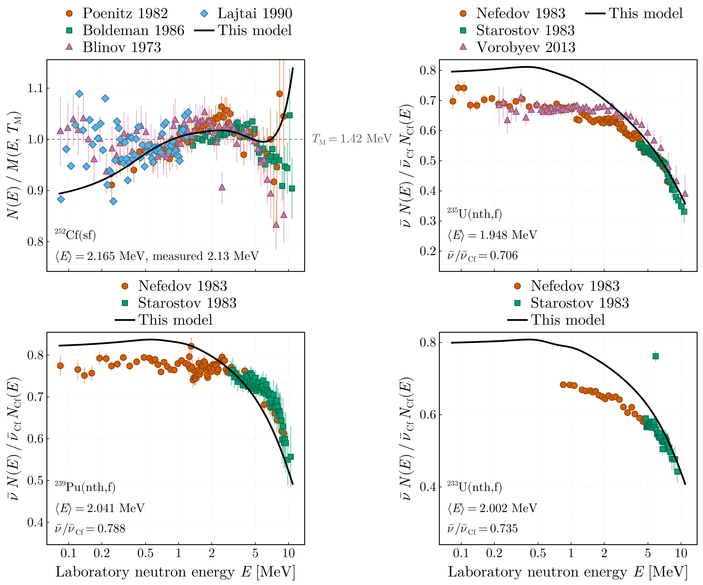
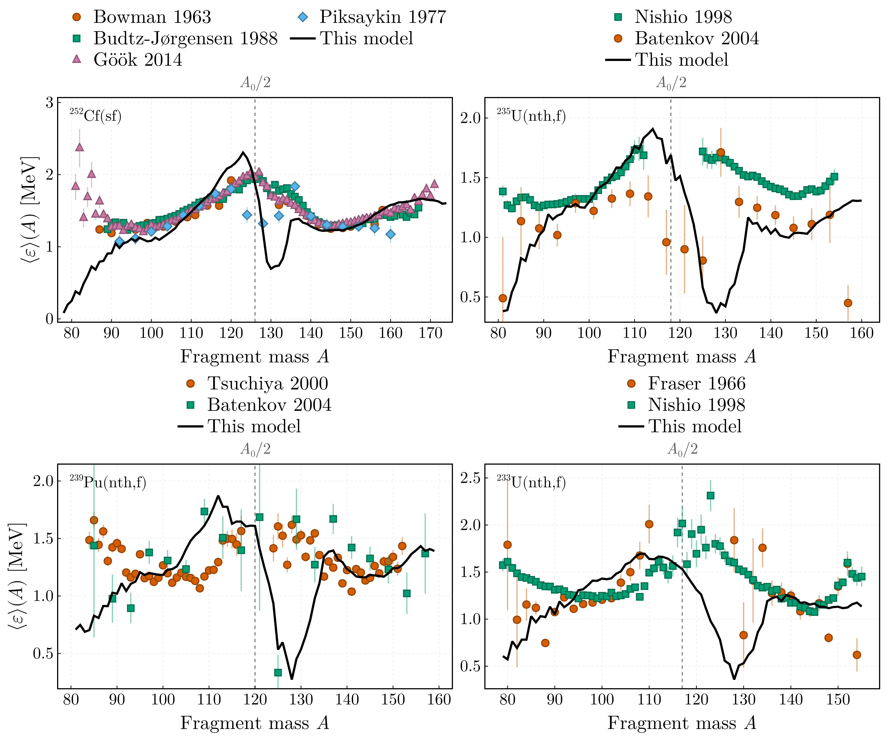
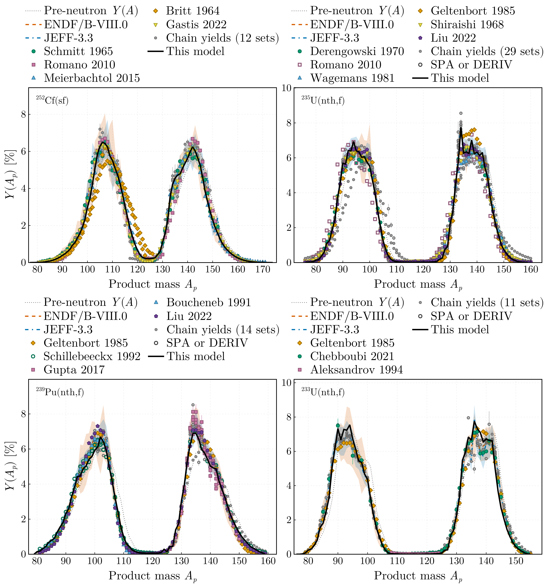

# DeterministicSequentialEmission.jl

[](https://github.com/PaulGoG/DeterministicSequentialEmission.jl/actions/workflows/CI.yml?query=branch%3Amain)
[](https://PaulGoG.github.io/DeterministicSequentialEmission.jl/stable/)
[](https://PaulGoG.github.io/DeterministicSequentialEmission.jl/dev/)
[](https://codecov.io/gh/PaulGoG/DeterministicSequentialEmission.jl)
[](https://github.com/JuliaTesting/Aqua.jl)
[](LICENSE)

DeterministicSequentialEmission.jl calculates prompt neutron emission from fission fragments in
low-energy and thermal fission, providing direct comparison with experimental prompt emission
observables and evaluated independent fission product yields. The package models prompt neutron
multiplicities as functions of fragment mass and total kinetic energy, `ν(A)` and `ν(TKE)`, the
mean centre-of-mass neutron energy `⟨ε⟩(A)`, the prompt fission neutron spectrum in both
centre-of-mass and laboratory frames, post-neutron product distributions and kinetic energies, and
the residual excitation energy available for prompt γ-ray de-excitation. The code evaluates
conservation of energy across each sequential emission stage for individual fragmentations `(A, Z)`
across the `TKE` distribution, integrating the cascade over empirical pre-neutron fragment yields.
Pre-configured setups are provided for ²⁵²Cf(sf), for thermal neutron-induced fission of
²³⁵U, ²³⁹Pu, and ²³³U, and for resonance-neutron fission of ²³⁵U at 580 eV.

The total excitation energy available to a nascent split is governed by
`TXE = Q + E*_CN − TKE`, where `Q` is the ground-state reaction Q-value and `E*_CN` is the compound
nucleus excitation energy. This total energy is partitioned between complementary fragments, yielding
the initial fragment excitation energies `E*_L` and `E*_H`. By default, the energy partition is
governed by the fragment temperature ratio `R_T(A_H) = T_L/T_H` as a function of heavy-fragment
mass; alternative partitions via tabulated excitation fractions `E*_H/TXE (A_H)` or scission-point
modelling are also supported. Following each successive neutron evaporation, the residual nucleus
retains excitation energy `Ē_r` at nuclear temperature `T`, which dictates the probability and
energetics of subsequent emissions.

## File structure

```
DeterministicSequentialEmission.jl/
├── src/                  library code behind the public interface
├── config/               one TOML per fissioning system, named for it, validated on load
├── scripts/              run.jl solves a system; stage_product_yields.jl stages evaluations
├── plotting/             CairoMakie environment; redraws figures from those tables
├── test/                 test suite, own environment (Aqua, JET, ExplicitImports)
├── docs/                 Documenter site, own environment
├── data/                 input data — see data/README.md; none of it ships
│   └── sims/             written by a run, data/sims/<system>/<run> — not tracked
├── results/              the model against measurement and evaluation: figures, sidecars, README
├── formatter/            version-bounded JuliaFormatter, so the gate cannot drift
├── check.jl              the gate: format, then test
├── activate.jl           activates and instantiates the root environment
└── Project.toml
```

<details>
<summary>Full tree</summary>

```
DeterministicSequentialEmission.jl/
├── src/
│   ├── DeterministicSequentialEmission.jl   the module and its exports
│   ├── partition.jl          TXE partition: scission modelling, E*_H/TXE, R_T
│   ├── evaporation.jl        evaporation cross sections and ⟨ε⟩
│   ├── sequences.jl          the sequential equations, emission chains, prompt γ energy
│   ├── products.jl           post-neutron product counts and distributions
│   ├── spectrum.jl           centre-of-mass and laboratory spectra
│   ├── configuration.jl      TOML schema and validation
│   └── pipeline.jl           run_pipeline, write_results, run identifiers
├── config/                   Cf252_sf, U235_nth, U235_nres, U233_nth, Pu239_nth
├── scripts/
│   ├── run.jl                entry point: solve a system, write its tables
│   └── stage_product_yields.jl   stages the evaluated independent product yields
├── plotting/                 activate.jl, Project.toml, theme.jl, figures.jl
├── test/
│   ├── activate.jl, Project.toml
│   ├── runtests.jl           the suite, then Aqua, ExplicitImports, JET
│   ├── physics.jl            the configuration of the thesis calculation, shared helpers
│   ├── test_*.jl             unit tests by topic
│   └── references/
│       ├── README.md         what the pinned tables are and how they were produced
│       └── Cf252_sf/         pinned tables of the thesis calculation
├── docs/
│   ├── activate.jl, Project.toml, make.jl
│   └── src/                  index, running, naming, domain, energetics, emission, references,
│                             refs.bib
├── data/
│   ├── README.md             what each file is and where to obtain it
│   ├── reference/            evaluations that belong to no one system; not tracked
│   ├── <system>/             input data per fissioning system — not tracked
│   └── sims/<system>/<run>/  tables and provenance of a run — not tracked
├── results/
│   ├── README.md             the model against measurement and evaluation
│   ├── multiplicity_vs_experiment, prompt_neutron_spectrum, mean_neutron_energy_vs_experiment
│   ├── product_mass_yield, product_charge_yield, product_independent_yield_<system>,
│   │   product_neutron_number_yield, product_kinetic_energy,
│   │   product_kinetic_energy_by_charge, product_total_kinetic_energy
│   ├── prompt_gamma_energy_per_fission, prompt_gamma_energy_cf252
│   │                         each as .pdf, .png and a .toml sidecar, tracked
│   └── residual_quantities, charge_distribution    diagnostics, not tracked
├── formatter/                activate.jl, Project.toml — version-bounded JuliaFormatter
├── .github/                  CI workflow and Dependabot configuration
├── .JuliaFormatter.toml
├── .gitattributes
├── .gitignore
├── activate.jl
├── check.jl
├── CHANGELOG.md
├── CITATION.cff
├── LICENSE
└── Project.toml
```

</details>

## Getting started

Julia 1.11 or later. Clone the repository; every environment then activates and instantiates
itself, FissionFragmentsDomain.jl being resolved from its repository URL:

```
git clone https://github.com/PaulGoG/DeterministicSequentialEmission.jl
cd DeterministicSequentialEmission.jl
julia activate.jl                      # root environment
julia test/activate.jl                 # test environment
julia docs/activate.jl                 # documentation environment
julia plotting/activate.jl             # plotting environment
```

Run the gate, formatting against `.JuliaFormatter.toml` with the version-bounded JuliaFormatter
and then the test suite with its static analysis:

```
julia check.jl --check    # fail on formatting differences without rewriting, then test
julia check.jl            # format in place, then test
```

The test suite runs on a bare clone. The mass table it needs ships with FissionFragmentsDomain.jl,
and a test that needs staged input data is reported as skipped.

A run needs the input data under `data/`, none of which ships: the fragment yields, the staged
temperature-ratio runs and, for the figures, the measurements. [data/README.md](data/README.md)
records every file and the commands that obtain it. If required input data are missing,
`scripts/run.jl` terminates on load and reports the first missing file. With the data in place, solve
one fissioning system:

```
julia scripts/run.jl config/Cf252_sf.toml                    # inputs under data/
julia scripts/run.jl config/Cf252_sf.toml <data directory>   # inputs under another root
```

That writes `data/sims/Cf252_sf/<run>/`:
- `ν`, `T`, `E*`, `Ē_r` and `⟨ε⟩` against fragment mass, `nu_vs_A.dat`, `T_vs_A.dat`,
  `E_star_vs_A.dat`, `E_r_vs_A.dat` and `eps_vs_A.dat`, and `ν` and `E*` against TKE,
  `nu_vs_TKE.dat` and `E_star_vs_TKE.dat`;
- the fragment yield projections and the laboratory spectrum, `spectrum_vs_E.dat`;
- the post-neutron product distributions;
- the energy the neutrons leave for prompt γ rays, per fragment against its mass,
  `E_gamma_vs_A.dat`, and summed over the two fragments of a split against the mass of either
  and against TKE, `E_gamma_tot_vs_A.dat` and `E_gamma_tot_vs_TKE.dat`;
- under the default bound of the yield on TKE, the measured and retained moments of every mass,
  `TKE_bound_vs_A.dat`;
- the charge-distribution diagnostics and a table of totals, `totals.dat`;
- the provenance: `metadata.toml`, recording the configuration, the package version, the commit
  and the platform, beside copies of the configuration and the resolved `Manifest.toml`.

The [naming page](docs/src/naming.md) lists every table with its content. `<run>` is the run
identifier, built from the configuration keys that change the result, so two runs of one system
that differ in any of them land in separate directories. Each key enters as a short token: `pc`
is `[products] count`, and `TKEb` stands for the bound of the yield on TKE, `"grid"` or the
moments the physical bound restores. Existing outputs are preserved: if a directory for `<run>`
already exists, it is archived with a sequential numerical suffix (`<run>#1`, `<run>#2`, ...)
before the new calculation is written.

Redraw the figures from what those runs wrote, without solving anything again:

```
julia plotting/figures.jl [runs directory] [data directory] [figures directory]
```

The three arguments default to `data/sims/`, `data/` and `results/`. The script draws ²⁵²Cf(sf),
²³⁵U, ²³⁹Pu and ²³³U(n_th,f), each from its most recently written run; runs moved aside are
skipped, and the resonance run of ²³⁵U is not drawn. The comparison figures of
[results/README.md](results/README.md) set `ν(A)`, the spectra, `⟨ε⟩(A)` and the prompt γ
energy against the measured sets, each listed there with its reference, and the post-neutron
products against the evaluated independent yields and the measured product yields. Without the
retrieved data the figures carry the model alone.

Two further figures have no experimental counterpart; they are diagnostics and are not tracked.
One draws the quantities internal to the emission chain, `E*(A)`, `Ē_r(A)`, `⟨T⟩(A)` and
`⟨ε⟩(A)`. The other draws the charge distribution each run was weighted by, Wahl's model with
the reaction's own 1988 parameters, against the alternatives: the 2002 systematics of Wahl
(LANL report LA-13928, doi:10.2172/809574) and the conventional means. Every figure is exported
as PDF and PNG beside a `.toml` sidecar naming, per system, the run drawn, the commit its
metadata records and the measured files.

The charge-distribution diagnostic shows where a reaction's own parameters and the systematics
part company, which is the uncertainty a system without a fit of its own inherits. It also shows
where a run given a table has fallen off the end of that table onto the flat fallback.

Stage the evaluated independent fission product yields of ENDF/B-VIII.0 and JEFF-3.3, which the
product figures compare against, from the public ENDF-6 files:

```
julia scripts/stage_product_yields.jl [data directory] [--library <library>] [--system <system>]
```

[data/README.md](data/README.md) describes the tables it writes and its remaining options.

Build the documentation into `docs/build/`:

```
julia docs/make.jl
```

## Status

| Component | State |
|---|---|
| Package environment, test and docs environments | done |
| Continuous integration, dependency updates, docs deployment | test matrix on Julia 1.11 and current stable, the formatting gate, a configuration check, Documenter deployment; Dependabot weekly |
| Fragmentation domain, masses, charge distribution, level density, yields | from `FissionFragmentsDomain.jl` 0.2.4 |
| One name per quantity, from configuration key to column header ([naming](docs/src/naming.md)) | done |
| TXE partition — scission modelling, `E*_H/TXE (A_H)`, `R_T (A_H)` | done |
| Fragment yield bounded at `TKE < Q + E*_CN`, the measured `⟨TKE⟩(A)` restored; the grid bound of 0.1.x as an option | done |
| Sequential equations — constant and variable evaporation cross section | done |
| Prompt fission neutron spectrum — centre-of-mass and laboratory, in closed form | done |
| Post-emission distributions — `Y_p(A_p)`, `Y_p(Z, A_p)`, `Y_p(N_p)`, `E_K_p`, `TKE_p`, two product counts | done |
| Prompt γ energy — the excitation the neutrons leave, per fragment and per fission | done |
| Configuration, provenance, entry point | done |
| Figures (CairoMakie), redrawn from written tables; [results/README.md](results/README.md) | done |

## The model

In contrast to global statistical treatments—such as the Los Alamos model of Madland and Nix
(1982), which integrates evaporation spectra over an assumed triangular residual temperature
distribution—the Deterministic Sequential Emission (DSE) framework tracks individual de-excitation
cascades sequence by sequence across the complete pre-neutron fragmentation space.

### Energy conservation and sequential cascade

For a given pre-neutron fragment `(A, Z)` at initial excitation energy `E*`, the de-excitation
cascade proceeds through discrete neutron emissions `k = 1 … k_max`. At each step `k`,
energy conservation is evaluated explicitly:

```
Ē_r^(k-1) − Sₙ^(k-1) − ⟨ε⟩_k = a_k T_k²,    k = 1 … k_max
```

where:
- `Ē_r^(k-1)` is the residual excitation energy before the `k`-th emission, with initial
  condition `Ē_r^(0) = E*`;
- `Sₙ^(k-1)` is the neutron separation energy of the emitting precursor nucleus `(A − (k − 1), Z)`;
- `⟨ε⟩_k` is the mean centre-of-mass kinetic energy of the `k`-th evaporated neutron;
- `a_k` and `T_k` are the nuclear level density parameter and residual nuclear temperature of the
  daughter nucleus `(A − k, Z)`, connected via the Fermi-gas equation of state `Ē_r^(k) = a_k T_k²`.

The cascade step equation is solved successively while the available excitation satisfies
`Ē_r^(k-1) ≥ Sₙ^(k-1)` and admits a physical temperature solution (`T_k > 0`), terminating
at `k_max`. The subsequent emissions that remain energetically possible when the emitted neutrons'
kinetic energy is accounted for are evaluated against separation thresholds on `Sₙ` alone. This
defines the maximum allowable sequence count `n ≥ k_max` for configuration `(A, Z, TKE)`, from
which the average prompt neutron multiplicity is calculated:

```
ν(A, Z, TKE) = (n + 1) / 2
```

The residual excitation energy remaining after neutron emission ceases,

```
E_γ = Ē_r^(n) = E* − Σ_{k=1}^n (Sₙ^(k-1) + ⟨ε⟩_k)
```

is retained in the residual nucleus and dissipated through prompt γ-ray emission.

### Excitation energy partition at scission

The total excitation energy (TXE) available to a complementary fragment split `(A_L, Z_L) + (A_H, Z_H)`
at total kinetic energy `TKE` is determined by the reaction energy balance:

```
TXE(A, Z, TKE) = Q(A, Z) + E*_CN − TKE
```

where `Q(A, Z)` is the ground-state mass difference of the split and `E*_CN` is the
compound nucleus excitation energy.

This energy is partitioned between the light and heavy fragments using the temperature ratio
`R_T(A_H) = T_L/T_H`, following the formulation developed for the Point-by-Point (PbP) model:

```
E*_H / TXE = 1 / (1 + R_a R_T²(A_H))
```

where `R_a = a_L / a_H` is the ratio of fragment level density parameters. In this package,
`R_T(A_H)` is obtained from the model-independent inversion of measured prompt neutron multiplicities
`ν(A)` implemented in `FissionTemperatureRatio.jl`.

### Evaporation spectra and laboratory kinematics

Neutron evaporation from fully accelerated fragments is described by Weisskopf-Ewing statistical
theory. In the centre-of-mass frame of the moving fragment, the evaporation spectrum for step `k`
is evaluated in closed form using energy-dependent or constant inverse reaction cross sections.

The laboratory prompt fission neutron spectrum `N(E)` is obtained by transforming the centre-of-mass
distribution assuming isotropic emission in the fragment rest frame:
- The laboratory transformation accounts for the kinematic boost imparted by the fragment's
  pre-neutron kinetic energy `E_K = TKE (A₀ − A)/A₀`.
- Within a fragment cascade of length `n`, the `k`-th emission contributes with its emission
  probability `(n + 1 − k)/n` under `ν = (n+1)/2`.
- Laboratory spectra are integrated over all fragmentations `(A, Z, TKE)` weighted by the
  fragment yield `Y(A, Z, TKE)` and normalized according to international evaluation standards
  (Capote et al., 2016).

### Post-neutron product distributions

Because the allowable sequence count `n` is an integer for every configuration `(A, Z, TKE)`,
post-neutron product masses `A_p ∈ [A − n, A]` remain discrete integers without artificial rounding.
This property makes the DSE formulation particularly suitable for predicting independent fission product
yields `Y_p(A_p, Z)` and product kinetic energies `E_K_p`:
- **Emission-probability count (default)**: The cascade terminates on each of its `n` residual stages
  with equal probability `1/n`, yielding `P(A_p = A − k) = 1/n` (`k = 1 … n`). This formulation
  ensures exact mass conservation, so that the mean mass loss per fragment equals the calculated
  multiplicity: `⟨A − A_p⟩ = ν`.
- **Sequence count (`[products] count = "sequence_count"`)**: Imposes `A_p = A − n` with probability
  one, reproducing the convention of Tudora (2022). While this represents the maximum possible
  depletion, it removes `⟨n⟩ ≈ 2ν − 1` mass units on average.
- Post-neutron product kinetic energies `E_K_p = E_K A_p/A` and total product kinetic energy
  `TKE_p = E_K_p,L + E_K_p,H` follow the kinematic relations of Tudora (2022), assuming
  isotropic emission leaves average fragment velocities unchanged.

### Scientific provenance and literature lineage

The physical models and empirical parameterizations implemented in this package originate from the
following primary literature:

1. **Deterministic Sequential Emission framework**:
   - Original sequential cascade formulation: Tudora, Hambsch, and Tobosaru, *Eur. Phys. J. A* **54**,
     87 (2018), doi:10.1140/epja/i2018-12521-7.
   - Systematic behavior of residual quantities: Tudora, *Eur. Phys. J. A* **56**, 84 (2020),
     doi:10.1140/epja/s10050-020-00059-2.
   - Experimental validation of deterministic modeling: Tudora, Hambsch, and Morariu,
     *Eur. Phys. J. A* **55**, 98 (2019), doi:10.1140/epja/i2019-12782-6.
   - Methodological comparison of DSE and Point-by-Point models: Tudora and Hambsch,
     *EPJ Web Conf.* **256**, 00017 (2021), doi:10.1051/epjconf/202125600017.
   - Post-neutron product yields and product energetics: Tudora, *Eur. Phys. J. A* **58**, 126 (2022),
     doi:10.1140/epja/s10050-022-00766-y; extended to ²³⁹Pu(n_th,f) in Tudora et al.,
     *Eur. Phys. J. A* **60**, 25 (2024), doi:10.1140/epja/s10050-024-01232-7, and to ²³³U(n_th,f) in
     Tudora, *Eur. Phys. J. A* **61**, 210 (2025), doi:10.1140/epja/s10050-025-01662-x.
2. **Excitation energy partition**:
   - Foundational Point-by-Point partition by `R_T(A_H)`: Tudora and Hambsch,
     *Eur. Phys. J. A* **53**, 159 (2017), doi:10.1140/epja/i2017-12347-9.
   - Model-independent extraction of `R_T(A_H)` from measured `ν(A)`: Tudora and Gogîță,
     *Eur. Phys. J. A* **60**, 190 (2024), doi:10.1140/epja/s10050-024-01375-7.
3. **Evaporation theory and spectral transformations**:
   - Statistical evaporation theory: Weisskopf, *Phys. Rev.* **52**, 295 (1937),
     doi:10.1103/PhysRev.52.295.
   - Closed-form centre-of-mass spectrum and laboratory transformation: Terrell, *Phys. Rev.* **113**,
     527 (1959), doi:10.1103/PhysRev.113.527; Madland and Nix, *Nucl. Sci. Eng.* **81**, 213 (1982),
     doi:10.13182/NSE82-5.
   - Multiplicity and angular emission distributions: Märten and Seeliger, *J. Phys. G: Nucl. Phys.*
     **10**, 349 (1984), doi:10.1088/0305-4616/10/3/010; Kawano et al., *Phys. Rev. C* **104**,
     014611 (2021), doi:10.1103/PhysRevC.104.014611.
   - International evaluation standards for prompt fission neutron spectra: Capote et al.,
     *Nucl. Data Sheets* **131**, 1 (2016), doi:10.1016/j.nds.2015.12.002.
4. **Nuclear inputs and structure models**:
   - Atomic masses, reaction Q-values, and neutron separation energies: AME2020 evaluation, Wang et al.,
     *Chin. Phys. C* **45**, 030003 (2021), doi:10.1088/1674-1137/abddaf; Huang et al.,
     *Chin. Phys. C* **45**, 030002 (2021), doi:10.1088/1674-1137/abddb0.
   - Isobaric charge distributions: A. C. Wahl, *At. Data Nucl. Data Tables* **39**, 1 (1988),
     doi:10.1016/0092-640X(88)90016-2, and LA-13928 (2002), doi:10.2172/809574.
   - Nuclear level densities: Back-Shifted Fermi Gas model of von Egidy and Bucurescu,
     *Phys. Rev. C* **72**, 044311 (2005), doi:10.1103/PhysRevC.72.044311; *Phys. Rev. C* **80**,
     054310 (2009), doi:10.1103/PhysRevC.80.054310; and Gilbert and Cameron, *Can. J. Phys.* **43**,
     1446 (1965), doi:10.1139/p65-139.
   - Pre-neutron fragment yields `Y(A, TKE)`: Experimental compilations retrieved from the IAEA
     EXFOR library via `ExforFissionData.jl`.
5. **Software lineage**:
   - The present library is a modular, high-performance Julia re-implementation of the computational
     code originally created for my 2023 MSc thesis (Faculty of Physics, University of Bucharest,
     supervised by Prof. Anabella Tudora).
   - Numerical regression against my thesis reference calculations is documented under *Provenance*.



The characteristic sawtooth structure of `ν(A)` emerges directly from the excitation energy partition
without empirical tuning: total excitation energy is shared between nascent fragments by the
temperature ratio `R_T(A_H)` extracted from measured `ν(A)` data via FissionTemperatureRatio.jl, the
sequential cascade is solved configuration by configuration, and the result is folded with the
empirical pre-neutron fragment yield `Y(A, TKE)`. Total prompt multiplicities agree within 5.5 %
of evaluated standards (−5.4 % for ²⁵²Cf, +4.0 % for ²³⁵U, −2.3 % for ²³⁹Pu, and +5.5 % for ²³³U)
without system-specific parameter adjustments.



The prompt fission neutron spectrum provides an independent test of the sequential evaporation energetics.
Both model calculations and experimental datasets are compared on an absolute basis: the ²⁵²Cf spectrum
integrates to one neutron by construction, and every retrieved dataset is evaluated against the same
1.42 MeV Maxwellian distribution. The thermal systems were measured as the ratio of their spectrum per
fission to that of ²⁵²Cf, and the model constructs that ratio using its own calculated multiplicities
without arbitrary renormalisation. Each fragmentation enters the total spectrum weighted by its
yield times its multiplicity, so that every emitted neutron contributes with unit weight, as in a
measurement. Within a fragment cascade of length `n`, the `k`-th emitted neutron contributes with
weight `(n+1−k)/n`, corresponding to its emission probability under `ν = (n+1)/2`. The calculated mean
laboratory energy of ²⁵²Cf(sf) is 2.17 MeV (compared with 2.13 MeV evaluated standard), and those of
the three thermal systems are 1.95, 2.04, and 2.00 MeV for ²³⁵U, ²³⁹Pu, and ²³³U, respectively. The
calculated ²⁵²Cf spectrum reproduces the measured shape between 0.3 and 5 MeV, but falls below the
data below 0.3 MeV and above them beyond 6 MeV. In the ratios to ²⁵²Cf, the low-energy offset reflects
the pair multiplicity ratio error (`ν̄/ν̄_Cf` is 0.706 for ²³⁵U against 0.642 evaluated). The
progressive softening of the thermal spectra relative to ²⁵²Cf is reproduced for both uranium isotopes,
while showing a steeper falloff above 5 MeV for ²³⁹Pu. By comparison, the uniform sequence average of
Tudora *et al.* (2018) and my thesis (`[spectrum] sequence_weighting = "uniform"`) shifts the
mean laboratory energies 4 to 7 % below the measured values.



The mean centre-of-mass energy of a fragment's neutrons, `⟨ε⟩(A)`, is obtained directly from the
sequence-averaged energy balance without adjustable parameters. It follows experimental trends along
both mass wings, where emitted neutron energies are governed by the residual temperature determined
by the sequence balance. Systematic deviations occur in the mass range `A ≈ 126`–`134` near the
`N = 82` spherical shell closure, where fragments have minimal excitation and low calculated
emission, as well as below `A ≈ 90`, where the model underestimates experimental means.
[results/README.md](results/README.md) details each dataset, reference, and additional output tables.



The post-neutron product mass yield `Y_p(A_p)` reflects the pre-neutron fragmentation distribution
mapped through the sequential de-excitation cascade. In the default emission-probability weighting, a
fragment with `n` allowable sequences terminates on each residual mass `A − k` (`k = 1 … n`) with
equal probability `1/n`, preserving average mass loss equal to calculated multiplicity:
`⟨A − A_p⟩ = ν`. When compared with evaluated independent fission yields of ENDF/B-VIII.0 and JEFF-3.3
summed over charge, the centroids of both the light and heavy mass peaks agree within 0.8 u across all
four systems. The fine structure of the heavy peak (notably the even-`Z` enhancements at `A_p = 134`
and `138` in ²³⁵U) emerges naturally from a smooth pre-neutron yield. Experimental post-neutron mass
yields and chain yields from EXFOR exhibit scatter comparable to the difference between the model and
evaluations. The sequence count convention (`A_p = A − n`) remains selectable via
`[products] count = "sequence_count"`, reproducing the post-neutron mass yields of my thesis
calculations. [results/README.md](results/README.md) presents the remaining product distributions
(elemental yields, isotopic chains, and neutron-number distributions around `N_p = 82`) alongside
product kinetic energies.

Several systematic discrepancies with experimental data highlight specific physical limitations of
the underlying cascade assumptions (the fixed-mass slopes and neutron multiplicity distributions
are evaluated directly from configuration emission chains):
- The multiplicity relation `ν = (n+1)/2` exhibits an overly weak response to excitation energy. At
  fixed fragment mass, `−dTKE/dν` is 11.5 MeV per neutron for ²⁵²Cf compared with 7.3 MeV measured
  (Göök *et al.*, doi:10.1103/PhysRevC.90.064611), leading to an excessively broad neutron multiplicity
  distribution `P(ν)` across all systems. For ²⁵²Cf, the calculation leaves 10.3 MeV per fission for
  prompt γ rays (`E_gamma_per_fission`), compared with 6.8 MeV measured by Nifenecker *et al.*
  (doi:10.1016/0375-9474(72)90296-5). Prompt-γ measurements from EXFOR show consistent trends: the
  residual energy decreases with TKE at −0.17 MeV/MeV compared with −0.063 MeV/MeV measured for ²⁵²Cf
  (Mehta *et al.*, doi:10.1103/PhysRevC.7.373).
- While the absolute spectrum of ²⁵²Cf is improved by the emission-probability weighting, the thermal
  spectra relative to ²⁵²Cf yield larger χ²/N (2.5 to 5.1 compared with 1.9 to 4.1 under uniform
  averaging), because the uniform softness largely cancels in spectral ratios whereas the residual
  3 to 4 % difference in mean energy does not.
- `⟨ε⟩` decreases too rapidly with TKE at fixed fragment mass under both sequence weightings: for
  ²⁵²Cf, `d⟨ε⟩/dTKE` is −0.028 MeV/MeV under default weighting, compared with −0.018 MeV/MeV deduced
  from Bowman *et al.* (doi:10.1103/PhysRev.129.2133).

## Configuration

Each calculation is fully specified by a single TOML configuration file. [config/Cf252_sf.toml](config/Cf252_sf.toml) is the
annotated reference for a measured joint yield `Y(A, TKE)`, and
[config/U235_nth.toml](config/U235_nth.toml) for a yield reconstructed from marginals, which names
`mass_yield_file`, `mean_kinetic_energy_file` and `kinetic_energy_dispersion_file`. The other
three follow the second, each on its own domain and kinetic energy grid. Each is named for the
system it declares, and the test suite asserts that, so a file cannot drift from what it runs.
Each key carries its allowed values or its bounds as a comment, and the loader enforces what the
comment states. A configuration that cannot be honoured fails on load, naming the key.

| System | Configuration | Note |
|---|---|---|
| ²⁵²Cf(sf) | `Cf252_sf.toml` | the system of my thesis calculation |
| ²³⁵U(nth,f) | `U235_nth.toml` | |
| ²³⁹Pu(nth,f) | `Pu239_nth.toml` | |
| ²³³U(nth,f) | `U233_nth.toml` | |
| ²³⁵U(nres,f) at 580 eV | `U235_nres.toml` | the resonance-region beam the GELINA measurements use |

Fissioning systems are identified by tokens of the form `<ElementSymbol><A>_<entrance channel>`
using standard physical designations (such as `nth` for thermal neutrons and `sf` for spontaneous
fission). This token designates the configuration file, the corresponding input tree under `data/`,
and the simulation output directory under `data/sims/`, distinguishing different incident energy
regimes (such as thermal and resonance fission of ²³⁵U) unambiguously.

Every fragment yield comes from EXFOR through ExforFissionData.jl v0.8.0. ²⁵²Cf takes the measured
`Y(A,TKE)` matrix of Göök et al. (2014), doi:10.1103/PhysRevC.90.064611. For the three thermal
systems no joint `Y(A,TKE)`
exists in the archive, so the yield is reconstructed from one experiment's `Y(A)` and
`⟨TKE⟩(A)`:
- Al-Adili et al. (2016), doi:10.1103/PhysRevC.93.034603, for ²³⁵U;
- Wagemans et al. (1984), doi:10.1103/PhysRevC.30.218, for ²³⁹Pu;
- Geltenbort (1985), EXFOR 21981, for ²³³U.
None of them reports the width of the kinetic energy distribution, so it is borrowed and flagged:
- Baba et al. (1997), doi:10.1080/18811248.1997.9733759, EXFOR 23014003 and 23014002, for the two
  uranium isotopes;
- for ²³⁹Pu, Schillebeeckx et al. (1992), doi:10.1016/0375-9474(92)90296-V, EXFOR 22273023,
  measured in spontaneous fission of the
  same compound nucleus, ²⁴⁰Pu. With Wagemans's marginals it reproduces the mass-integrated width
  measured for ²³⁹Pu(nth,f) itself, 11.81 MeV, to 0.02 MeV.

Without any width, `⟨ν⟩` moves by +1.2 % for ²⁵²Cf and +3.9 % for ²³⁵U, measured by running one
experiment's matrix against its own marginals. The spread in TKE smooths the discrete emission
thresholds, which matters most at the low excitation of thermal fission.

The 580 eV resonance configuration for ²³⁵U demonstrates the insensitivity of prompt emission
observables to modest increases in excitation below the second-chance fission threshold. At 580 eV
incident energy, the compound nucleus excitation increases by only 5.8 × 10⁻⁴ MeV above thermal
(out of 6.5 MeV total excitation), shifting `ν(A)` by at most 9 × 10⁻³ neutrons (at `A = 111`, where
an additional configuration clears the physical TKE cutoff) and shifting total multiplicity by
6 × 10⁻⁶. Because the model treatment is effectively energy-independent over this sub-threshold
interval, experimental data obtained with low-energy resonance beams remain directly comparable to
thermal measurements. Above the second-chance fission threshold, multi-chance fission opens, which
falls outside the scope of the present model.

## Input data

Input datasets are maintained outside version control, as they comprise third-party scientific
evaluations, nuclear data libraries, and experimental compilations subject to their own provenance
and licensing terms. [data/README.md](data/README.md) records every file, its format and its source,
and points at the two companion packages that write this layout directly. The 2020 atomic mass
evaluation ships with FissionFragmentsDomain.jl, the domain package this one is built on, so
the tests pinned against the thesis calculation run on a bare clone.

Retrieved data is preferred. A measurement comes from EXFOR through `ExforFissionData.jl` if the
archive holds it. Where the retrieval has no joint `Y(A, TKE)`, the joint distribution is
reconstructed by `factorized_yield` from the two marginals it does hold, `Y(A)` and `⟨TKE⟩(A)`;
the thermal systems take this route. Static staged tables are supported for offline evaluation,
though all standard configurations rely on verified EXFOR retrievals. [data/README.md](data/README.md)
says which systems sit where.

To ensure thermodynamic and kinematic self-consistency, experimental inputs for a given system are
taken from a single complete measurement whenever possible. The pre-neutron distributions `Y(A)`,
`⟨TKE⟩(A)`, and `σ_TKE(A)` (or the joint matrix `Y(A, TKE)`) originate from the same experiment to
preserve common energy calibrations, mass scales, detector resolutions, and prompt-neutron
corrections. Marginal distributions from disparate experiments are neither spliced nor averaged
point-by-point; alternative datasets are retained for sensitivity studies.
The width `σ_TKE(A)` comes from the same experiment where it reported one; otherwise it is
borrowed from another experiment on the same system, preferring a pre-neutron width, and flagged.
The pre-neutron identities `Y(A) = Y(A₀ − A)`, and the same for `⟨TKE⟩` and `σ_TKE`, are imposed
by averaging the complements (`[yield] symmetrize = true`, the default). The
run record compares the input yield's mean TKE with the energy standard of Gönnenwein (1991), as
tabulated by Bertsch et al. (2015), doi:10.1088/0954-3899/42/7/077001: 184.1 MeV for ²⁵²Cf(sf);
170.1, 170.5 and 177.9 MeV for thermal ²³³U, ²³⁵U and ²³⁹Pu. A 1 MeV offset moves `⟨ν⟩` by
about 0.08.

No fragmentation can carry more total kinetic energy than its split releases: at
`TKE ≥ Q + E*_CN` the fragments have no excitation energy. By default
(`[yield] kinetic_energy_limit = "physical"`) each `P(TKE|A,Z)` is cut there and normalised per
`(A, Z)`, so `Y(A)` and `p(Z|A)` keep their measured values, and the measured moments are
restored over what remains. `kinetic_energy_moments = "mean"` re-centres a factorized Gaussian,
its width kept, so that the bounded mean equals `⟨TKE⟩(A)` (a measured matrix keeps its own row
means). `"mean_and_width"` re-scales it as well, and `"none"` leaves the bounded rows as they
fall. For a yield reconstructed from marginals the grid must then reach the largest
`Q + E*_CN` of the domain: a configuration whose `kinetic_energy_max + kinetic_energy_step` falls
short is refused, the error naming the least `kinetic_energy_max` that suffices. A measured
matrix is not checked, being cut where its own data end; the share of its yield a run reaches is
`yield_reached` in `totals.dat`. The share of the input yield whose masses lie in the domain
`heavy_mass_min`–`heavy_mass_max` (with their complements) is `yield_within_domain`; what lies
outside is renormalised away. Of the shipped inputs that is 0.60 % of the ²³⁹Pu yield, beyond
`A_H = 159`, 0.034 % of the ²³⁵U yield, 0.009 % of the ²⁵²Cf yield and none of the ²³³U yield.
`kinetic_energy_limit = "grid"` reproduces the 0.1.x results: a
Gaussian normalised over the grid, the configurations at `TXE ≤ 0` dropped, which put the solved
`⟨TKE⟩` of the thermal systems 0.12–0.22 MeV below the measured one. Every run records the solved
`⟨TKE⟩` and `σ_TKE` in its metadata, and a bounded run writes `TKE_bound_vs_A.dat`, the measured
and retained moments of every mass.

The isobaric charge distribution comes from Wahl's `Zₚ` model where no evaluated table is named.
The model, with its parameters, lives in the domain package, which resolves them from the
most specific source available for the system:

1. **the reaction's own least-squares parameters**, Wahl (1988), for ²³⁵U(n_th,f), ²³³U(n_th,f),
   ²³⁹Pu(n_th,f) and ²⁵²Cf(sf). The model reproduces that evaluation's own tables row by row.
2. **the 2002 systematics**, eq. (17) of LA-13928, for any nucleus in its fitted range;
3. **the conventional means**, `ΔZ = −0.5` and `σ_Z = 0.6` at every mass.

`charge_distribution_file = "wahl"` takes the first layer that covers the system, and the run
metadata records which; the shipped configurations use it. An evaluated table named in the
configuration outranks all three. The model exists because the independent yields in EXFOR, to
which it is fitted, are too sparse per mass to fit a Gaussian at each. Everything here is fitted
to spontaneous, thermal and resonance fission. Beyond the second-chance threshold multiple-chance
fission opens, and the model's separate high-energy branches would be needed.

## Companion packages

The fragmentation domain is [`FissionFragmentsDomain.jl`][ffd], a dependency resolved from its
repository. It covers nuclides, masses, charge distribution, level density, energetics, yields,
the temperature-ratio relation and run record. `R_T(A_H)` need not be supplied by hand:
[`FissionTemperatureRatio.jl`][ftr] extracts it from experimental prompt neutron multiplicity data
and tabulates it at every integer `A_H`, and [`ExforFissionData.jl`][exfor] retrieves that data,
and the yields and spectra, from the IAEA EXFOR archive. Neither of those two is a dependency;
this package reads only what they write.

A temperature-ratio curve is taken through the producing run's record. Copy that run's results
directory — its `manifest_<run>.toml` and the tables beside it — to
`data/<system>/temperature_ratio/`, and name it:

```toml
[partition]
method = "temperature_ratio"
subdirectory = "U235_nth/temperature_ratio"
curve_label = "systematic_trend"
```

The shipped configurations read the FissionTemperatureRatio.jl v0.5.1 runs on the
ExforFissionData.jl v0.8.0 retrieval of their inputs, staged that way for each system;
[data/README.md](data/README.md) gives the commands that reproduce them.

The manifest declares what its curves tabulate, and this package refuses one declaring anything
but `R_T` against `A_H`. The run writes `R_T(A_H)` and the multiplicity ratio `r_ν(A_H)` in the
same column of two files, and both are plausible numbers, so a curve picked by path can be the
wrong quantity and still run to completion. [data/README.md](data/README.md) lists what the
staged directory holds.

Produce that run with `ratio_averaging = "charge_resolved"`. This partition re-expands `R_T` with
per-`(A_H, Z_H)` level density parameters and reduces over `Z` afterwards, and only the
charge-resolved inversion undoes that exactly; either effective ratio, `⟨a_L⟩/⟨a_H⟩` or
`⟨a_L/a_H⟩`, misses by up to 10⁻² in `R_T`. A run whose manifest records its `[domain]` is checked
against the configuration: a different level density model or Gilbert–Cameron branch, number of
charges per mass, charge model or mass table is refused. So is a curve extracted with
`zero_polarization_at_symmetry = true`: this package centres the charge window of the symmetric
split on the charge model's own `ΔZ`, so such a curve was inverted on a different window.

The retrieval records which datasets it kept and which it rejected, with the reason. The archive
is not uniformly reliable: sets carrying `DERIV` are derived rather than measured, `SPA` means
averaged over a fission spectrum rather than a thermal one, and a handful of subentries are
miscoded and have to be established as per fragment from the data itself. The neutron
comparisons above draw no such set, and the product figures draw them with open markers.

[ffd]: https://github.com/PaulGoG/FissionFragmentsDomain.jl
[ftr]: https://github.com/PaulGoG/FissionTemperatureRatio.jl
[exfor]: https://github.com/PaulGoG/ExforFissionData.jl

## Provenance

The current codebase represents a complete modular re-implementation in Julia of the computational
framework originally developed for my 2023 MSc thesis (preserved on the
[`original`](../../tree/original) branch). The `main` branch reproduces the baseline physics while
introducing key refinements in spectrum weighting, mass-conserving product counts, and physical kinetic
energy constraints. Specifically, the per-neutron fragmentation average and the emission-probability
sequence weighting represent modern refinements; setting `[spectrum] average = "per_fission"` with
`sequence_weighting = "uniform"` restores my original thesis formulation.

The re-implementation is pinned against the ²⁵²Cf(sf) calculations of my 2023 MSc thesis, comprising
two runs I made with the code on the `original` branch under the `E*_H/TXE (A_H)` partition and the
`R_T (A_H)` partition. Reference output samples are preserved in `test/references/Cf252_sf/`
([README](test/references/README.md)). Both benchmarks specify `A_H ∈ [126, 174]`, `TKE = 130:2:230` MeV,
5 charge numbers per `A`, AME2020 masses, and variable evaporation cross sections. The test suite asserts
exact numerical agreement for `Q(A_H, Z_H)` across all 245 fragmentations, level density parameters
across all 244 physical nuclides, and `E*_L` and `E*_H` across 1,200 configurations under both
partitions. It similarly verifies 662 and 683 sequential cascade steps and fragment yield projections
over 97 masses, 41 charge numbers, and 101 kinetic energy steps.

Beyond the pinned sample, I reproduced both thesis runs against their full output, which is not
distributed: 9,819 and 9,788 configurations, and every one of the 44,679 and 45,070 emission sequences
they contain, each quantity to 5 × 10⁻⁹ MeV. That is exact agreement at the eight decimals that output
was written with. Both sequence counts match at every configuration. The fragment yield matrix is
reproduced cell for cell, 48,985 of them, and its projections to double precision. The averaged
observables close the chain: `ν(A)`, `T(A)`, `E*(A)` and `E*(TKE)` are reproduced over every mass and
kinetic energy to between 4 × 10⁻¹⁵ and 7 × 10⁻¹⁴ relative precision. The total averages are reproduced
to every digit the runs' summary file prints. My thesis runs predate the physical bound of the yield
on `TKE`; they are reproduced with `[yield] kinetic_energy_limit = "grid"`.

Because the prompt neutron spectrum was not tabulated in my original thesis output, I validated its
implementation instead against the analytical identities its derivation implies—unit area,
`⟨E⟩ = E_f + ⟨ε⟩`, and the second laboratory moment—across the complete fragmentation domain.

## How to cite

A published result that rests on this package should cite the software, the papers under *The
model* for the physics, and the measurements behind its input data as
[data/README.md](data/README.md) describes. [CITATION.cff](CITATION.cff) carries the same entry.

```bibtex
@software{Gogita_DeterministicSequentialEmission_jl,
  author  = {Gogîță, Paul-Adrian},
  title   = {DeterministicSequentialEmission.jl: prompt neutron emission from fission fragments, sequence by sequence},
  year    = {2026},
  url     = {https://github.com/PaulGoG/DeterministicSequentialEmission.jl},
  license = {MIT},
}
```

## Licence

MIT, see [LICENSE](LICENSE).
