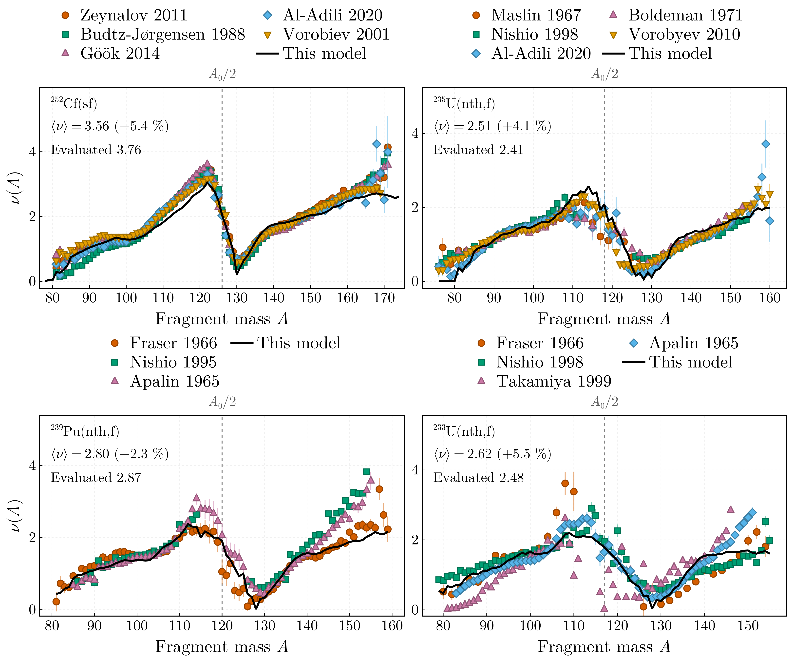
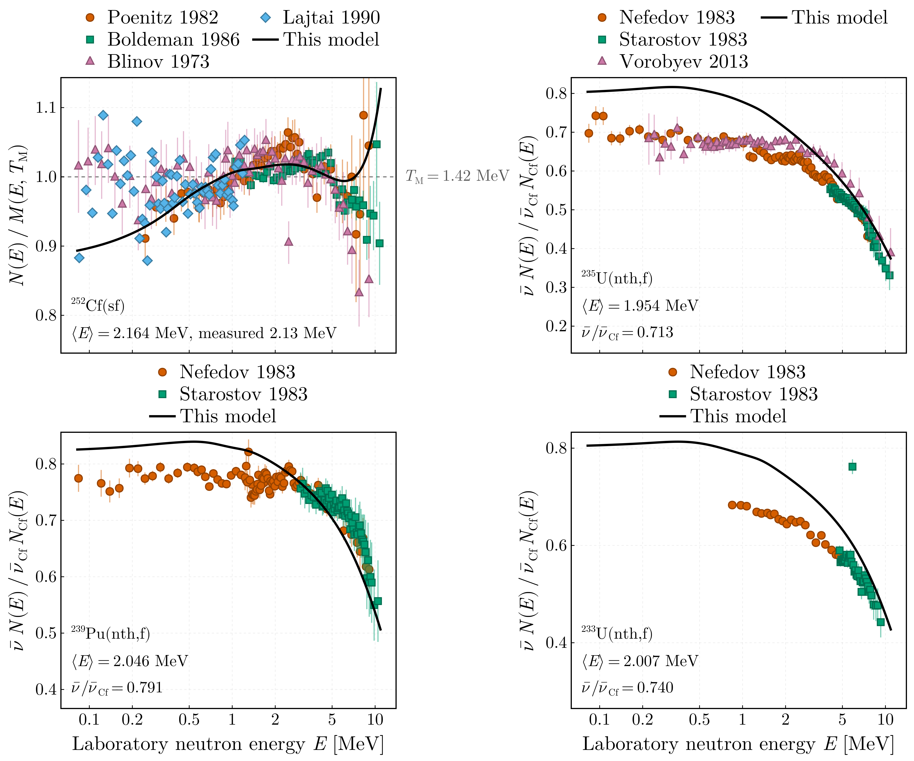
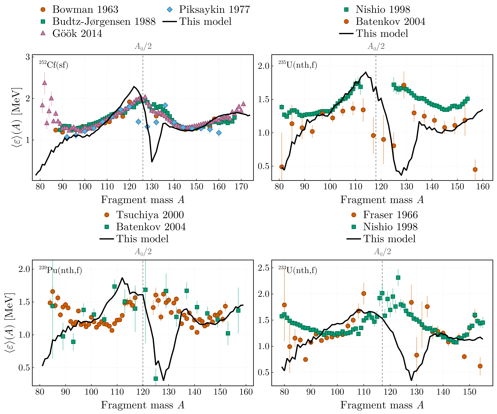
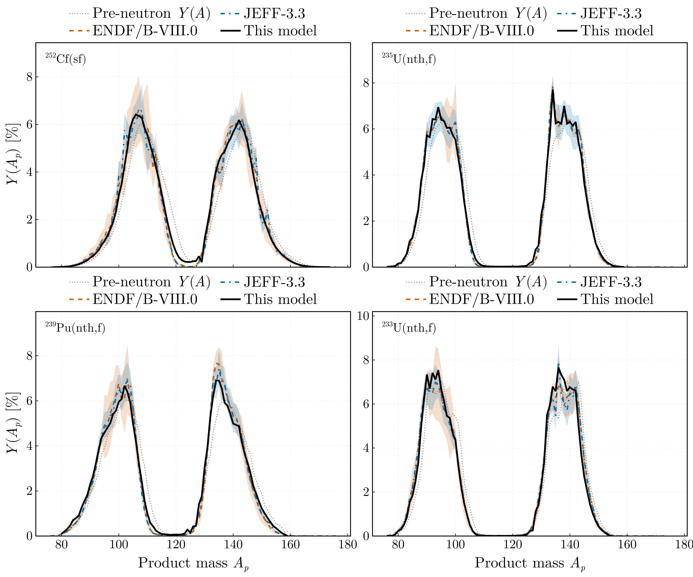

# Results: the model against measurement

The figures here are drawn by `plotting/figures.jl` from the tables one run per system wrote
under `data/sims/`, with nothing solved again and nothing fitted to the data shown. Each figure
is exported as PDF and PNG beside a `.toml` sidecar naming, per system, the run drawn, the commit
its metadata records and the measured files, so every panel traces to a configuration and a
commit. The measured side comes from EXFOR through ExforFissionData.jl v0.3.0, laid out as
`data/README.md` describes; the temperature ratios the runs were solved with are the
FissionTemperatureRatio.jl v0.3.0 trends staged beside them. The two diagnostic panels the
script also writes here, the residual quantities and the charge distribution, have no measured
counterpart and are not tracked.

```
julia scripts/run.jl config/<system>.toml    # one run per system, under data/sims/
julia plotting/figures.jl                    # redraws everything here from those runs
```

| System | ⟨ν⟩ | evaluated | | ⟨E⟩ [MeV] | ν̄/ν̄(²⁵²Cf) |
|---|---|---|---|---|---|
| ²⁵²Cf(sf) | 3.557 | 3.757 | −5.3 % | 2.164 (measured 2.13) | 1 |
| ²³⁵U(n_th,f) | 2.535 | 2.414 | +5.0 % | 1.954 | 0.713 (evaluated 0.643) |
| ²³⁹Pu(n_th,f) | 2.813 | 2.875 | −2.1 % | 2.046 | 0.791 (evaluated 0.765) |
| ²³³U(n_th,f) | 2.631 | 2.497 | +5.4 % | 2.007 | 0.740 (evaluated 0.665) |

The evaluated multiplicities are ENDF/B-VIII.0 for the induced systems and the Axton standard
for ²⁵²Cf. Datasets are labelled by author and the year of their EXFOR entry; the references
below give the publication, which for conference proceedings can be a later year.

## Prompt neutron multiplicity against fragment mass



The sawtooth is the signature observable and it is not fitted: the total excitation energy is
shared between the fragments by a temperature ratio `R_T(A_H)` extracted from measured `ν(A)`
by the companion package, the emission chain is solved configuration by configuration, and the
result is contracted against the measured fragment yield `Y(A, TKE)`. Each panel states the
total multiplicity against the evaluated value. The sets drawn are a fixed selection per system,
for legibility; `data/README.md` lists the whole retrieval.

| System | Dataset | EXFOR | Reference |
|---|---|---|---|
| ²⁵²Cf(sf) | Zeynalov 2011 | 23118006 | J. Korean Phys. Soc. **59**, 1396 (2011), doi:10.3938/jkps.59.1396 |
| | Budtz-Jørgensen 1988 | 23175008 | Nucl. Phys. A **490**, 307 (1988), doi:10.1016/0375-9474(88)90508-8 |
| | Göök 2014 | 23268005 | Phys. Rev. C **90**, 064611 (2014), doi:10.1103/PhysRevC.90.064611 |
| | Al-Adili 2020 | 23764010 | Phys. Rev. C **102**, 064610 (2020), doi:10.1103/PhysRevC.102.064610 |
| | Vorobiev 2001 | 41425014 | ISINN-9, JINR E3-2001-192, p. 288 (2001) |
| ²³⁵U(n_th,f) | Maslin 1967 | 21095002 | AWRE O-43/67 (1967) |
| | Nishio 1998 | 22464004 | Nucl. Phys. A **632**, 540 (1998), doi:10.1016/S0375-9474(98)00008-6 |
| | Al-Adili 2020 | 23764004 | as above |
| | Boldeman 1971 | 30909004 | Aust. J. Phys. **24**, 821 (1971), doi:10.1071/PH710821 |
| | Vorobyev 2010 | 41516012 | ISINN-17, p. 60 (2010) |
| ²³⁹Pu(n_th,f) | Fraser 1966 | 14369002 | Annu. Rev. Nucl. Sci. **16**, 379 (1966), doi:10.1146/annurev.ns.16.120166.002115 |
| | Nishio 1995 | 23012008 | J. Nucl. Sci. Technol. **32**, 404 (1995), doi:10.1080/18811248.1995.9731725 |
| | Apalin 1965 | 41397002 | Nucl. Phys. **71**, 553 (1965), doi:10.1016/0029-5582(65)90765-0 |
| ²³³U(n_th,f) | Fraser 1966 | 14369004 | as above |
| | Nishio 1998 | 22660005 | J. Nucl. Sci. Technol. **35**, 631 (1998), doi:10.1080/18811248.1998.9733919 |
| | Takamiya 1999 | 23595005 | J. Radioanal. Nucl. Chem. **239**, 117 (1999) |
| | Apalin 1965 | 41397004 | as above |

## Prompt fission neutron spectra



The ²⁵²Cf(sf) spectrum is drawn as the ratio of the model's unit-area laboratory spectrum to
a Maxwellian at 1.42 MeV, which is how every retrieved set reports it, so model and measurement
are both absolute. The three thermal systems were measured as the ratio of their spectrum per
fission to that of ²⁵²Cf(sf) with one detector, and the model is drawn the same way,
`ν̄ N(E) / ν̄_Cf N_Cf(E)` with its own multiplicities: the offset at low energy is the
multiplicity error of the pair, stated in each panel, and the fall with energy is the thermal
spectrum being the softer. Sets tabulated as ²⁵²Cf over the system are inverted, the two energy
ranges of one entry are joined under one label, and a set its record flags as superseded is
skipped.

| System | Dataset | EXFOR | Reference |
|---|---|---|---|
| ²⁵²Cf(sf) | Poenitz 1982 | 14278002 | Proc. Int. Conf. Nuclear Data for Science and Technology, Antwerp 1982, p. 465 |
| | Boldeman 1986 | 30775002 | Nucl. Sci. Eng. **93**, 181 (1986), doi:10.13182/NSE86-2 |
| | Blinov 1973 | 40418008 | Neutron Physics, Kiev 1973, vol. 4, p. 138 |
| | Lajtai 1990 | 41158003 | Nucl. Instrum. Methods A **293**, 555 (1990), doi:10.1016/0168-9002(90)90323-X |
| ²³⁵U(n_th,f) | Nefedov 1983 | 40871011, 40871012 | Neutron Physics, Kiev 1983, vol. 2, p. 285 |
| | Starostov 1983 | 40872007 | Neutron Physics, Kiev 1983, vol. 2, p. 290 |
| | Vorobyev 2013 | 41597002 | Vopr. At. Nauki Tekh., Ser. Yad. Konst. (1–2), 37 (2013); supersedes 41516017 |
| ²³⁹Pu(n_th,f) | Nefedov 1983 | 40871009, 40871010 | as above |
| | Starostov 1983 | 40872006 | as above |
| ²³³U(n_th,f) | Nefedov 1983 | 40871013 | as above |
| | Starostov 1983 | 40872008 | as above |

## Mean centre-of-mass neutron energy against fragment mass



Both sides are means in the centre of mass of the emitting fragment, as the retrieval records
for every set drawn. The model's `⟨ε⟩(A)` is the sequence average the energy balance returns,
over all neutron energies; the measured means are formed from spectra above a detector
threshold — 0.52 MeV in the laboratory for Bowman, 0.3 MeV for Budtz-Jørgensen, whose mean is
the first moment of the form fitted to the spectrum, 0.2 to 0.5 MeV for the others — which
raises them slightly where the fragment's neutrons are slow. The model follows the measured
values along both wings and fails in two places: the band `A ≈ 126`–`134` of heavy fragments
near the `N = 82` closure, which barely emit in the model and whose few neutrons are slow, and
the lightest fragments, `A < 90`, where it lies below the data.

| System | Dataset | EXFOR | Reference |
|---|---|---|---|
| ²⁵²Cf(sf) | Bowman 1963 | 14065003 | Phys. Rev. **129**, 2133 (1963), doi:10.1103/PhysRev.129.2133 |
| | Budtz-Jørgensen 1988 | 23175012 | Nucl. Phys. A **490**, 307 (1988), doi:10.1016/0375-9474(88)90508-8 |
| | Göök 2014 | 23268011 | Phys. Rev. C **90**, 064611 (2014), doi:10.1103/PhysRevC.90.064611 |
| | Piksaykin 1977 | 41689005 | Yad. Fiz. **25**, 723 (1977) |
| ²³⁵U(n_th,f) | Nishio 1998 | 22464003 | Nucl. Phys. A **632**, 540 (1998), doi:10.1016/S0375-9474(98)00008-6 |
| | Batenkov 2004 | 41502008 | AIP Conf. Proc. **769**, 1003 (2005), doi:10.1063/1.1945175 |
| ²³⁹Pu(n_th,f) | Tsuchiya 2000 | 22650008 | J. Nucl. Sci. Technol. **37**, 941 (2000), doi:10.1080/18811248.2000.9714976 |
| | Batenkov 2004 | 41502009 | as above |
| ²³³U(n_th,f) | Fraser 1966 | 14369005 | Annu. Rev. Nucl. Sci. **16**, 379 (1966), doi:10.1146/annurev.ns.16.120166.002115 |
| | Nishio 1998 | 22660003 | J. Nucl. Sci. Technol. **35**, 631 (1998), doi:10.1080/18811248.1998.9733919 |

## Post-neutron product mass yield



The product mass yield `Y(A_p)` is the pre-neutron yield carried through the emission chains.
A fragment whose chain allows `n` sequences ends on each of its `n` residuals with probability
`1/n`, so its products lie on `A − 1 … A − n`, and the mass its products have lost equals its
multiplicity exactly — 1.78 per fragment for ²⁵²Cf, the ⟨ν⟩ = 3.56 per fission of the sawtooth
figure. No parameter enters. The evaluated independent yields of ENDF/B-VIII.0 and JEFF-3.3,
summed over charge, are lines with their uncertainty as a band: they are evaluations, not
measurements. The run's own pre-neutron `Y(A)`, dotted, shows what the emission did: it moves
both humps inward by the mass lost, sharpens them, and builds the even-`Z` structure the
evaluations carry — the peaks at `A_p = 134` and `138` of ²³⁵U, at `134`–`136` of ²³⁹Pu, at
`136` of ²³³U — out of a pre-neutron yield that has none. The centroids of the two humps agree
with the evaluations within 0.8 u in every system.

| System | ⟨A_p⟩ light: model / ENDF/B-VIII.0 / JEFF-3.3 | ⟨A_p⟩ heavy | largest `Y(A_p)`: model / ENDF/B-VIII.0 |
|---|---|---|---|
| ²⁵²Cf(sf) | 106.9 / 106.1 / 106.2 | 141.7 / 141.9 / 142.1 | 106 (6.4 %) / 107 (6.6 %) |
| ²³⁵U(n_th,f) | 94.9 / 94.9 / 94.9 | 138.6 / 138.7 / 138.7 | 134 (7.7 %) / 134 (7.9 %) |
| ²³⁹Pu(n_th,f) | 98.9 / 99.0 / 99.0 | 138.3 / 138.1 / 138.2 | 134 (6.9 %) / 134 (7.7 %) |
| ²³³U(n_th,f) | 93.5 / 93.4 / 93.3 | 137.9 / 138.2 / 138.2 | 136 (7.7 %) / 93 (7.0 %) |

Where it departs: the heavy hump of ²³⁹Pu peaks at 6.9 % against 7.6–7.7 % evaluated, the
light hump of ²³³U at 7.5 % against 7.0 %, and the outer flank of the heavy hump of ²⁵²Cf falls
below the evaluations beyond `A_p ≈ 150`. The published prescription of the model, which
subtracts the full number of possible sequences from every fragment, is one key away,
`[products] count = "sequence_count"`; for ²⁵²Cf it removes 2.58 neutrons per fragment, 45 %
more than the multiplicity, and moves the humps a further 0.8 u inward.

| Library | Reference |
|---|---|
| ENDF/B-VIII.0, NFY and SFY sublibraries, MF8 MT454 at 0.0253 eV or spontaneous | Brown *et al.*, Nucl. Data Sheets **148**, 1 (2018), doi:10.1016/j.nds.2018.02.001 |
| JEFF-3.3, NFY and SFY, the same | Plompen *et al.*, Eur. Phys. J. A **56**, 181 (2020), doi:10.1140/epja/s10050-020-00141-9; NEA Data Bank record doi:10.82555/nhfqy-hvz09 |

Isomeric states are summed and uncertainties added in quadrature; JEFF-3.3's ternary particles
are left out. The measured post-neutron mass yields and independent yields of EXFOR are not
retrieved yet; when they are, they enter this figure as markers.

## Not drawn yet

The runs write more than the figures show, and the retrieval holds measurements the figures do
not yet use. Each of these enters this file with its figure and its dataset table when it is
ready.

- The independent yields `Y(A_p, Z)` and the product kinetic energies `KE_p(A_p)`, `KE_p(Z)`
  and `TKE_p`, which the runs write beside `Y(A_p)`, against the evaluations' independent yields
  and the measured post-neutron kinetic energies.
- The neutron number distribution `P(ν)`, against the retrieved `P_vs_nu` sets; the model's is
  known to be too broad in all four systems.
- `ν(TKE)` and `⟨ε⟩(TKE)`, which the runs write and the retrieval holds as `nu_vs_A_TKE` and
  `eps_vs_A_TKE` matrices for ²⁵²Cf and ²³³U.
- The thermal systems' spectra as ratios to a Maxwellian, which the retrieval holds for all
  three.
