# Results: the model against measurement

The figures here are drawn by `plotting/figures.jl` from the tables one run per system wrote
under `data/sims/`, with nothing solved again and nothing fitted to the data shown. Each figure
is exported as PDF and PNG beside a `.toml` sidecar naming, per system, the run drawn, the commit
its metadata records, the measured files and the retrieved sets left out, so every panel traces
to a configuration and a commit. The measured side comes from EXFOR through ExforFissionData.jl
v0.5.0, laid out as [data/README.md](../data/README.md) describes, and a dataset is drawn as its
`retrieval.toml` records it; the temperature ratios the runs were solved with are the
FissionTemperatureRatio.jl v0.4.0 trends staged beside them. The two diagnostic panels the
script also writes here, the residual quantities and the charge distribution, have no measured
counterpart and are not tracked.

```
julia scripts/run.jl config/<system>.toml    # one run per system, under data/sims/
julia plotting/figures.jl                    # redraws everything here from those runs
```

| System | ⟨ν⟩ | evaluated | | ⟨E⟩ [MeV] | ν̄/ν̄(²⁵²Cf) |
|---|---|---|---|---|---|
| ²⁵²Cf(sf) | 3.557 | 3.759 | −5.4 % | 2.164 (measured 2.13) | 1 |
| ²³⁵U(n_th,f) | 2.513 | 2.414 | +4.1 % | 1.949 | 0.707 (evaluated 0.642) |
| ²³⁹Pu(n_th,f) | 2.802 | 2.868 | −2.3 % | 2.043 | 0.788 (evaluated 0.763) |
| ²³³U(n_th,f) | 2.616 | 2.479 | +5.5 % | 2.003 | 0.735 (evaluated 0.659) |

The evaluated multiplicities are the prompt ones, as the model computes: ENDF/B-VIII.0 (Brown
et al. 2018, doi:10.1016/j.nds.2018.02.001), MF1 MT456 at 0.0253 eV for the induced systems, and
for ²⁵²Cf(sf) the constant of its decay sublibrary, Axton's total 3.7676 less the delayed 0.0086. Datasets are labelled by author and the year of their EXFOR entry; the references
below give the publication, which for conference proceedings can be a later year.

## Prompt neutron multiplicity against fragment mass


The sawtooth is the signature observable and it is not fitted: the total excitation energy is
shared between the fragments by a temperature ratio `R_T(A_H)` extracted from measured `ν(A)`
by FissionTemperatureRatio.jl, the emission chain is solved configuration by configuration, and the
result is contracted against the measured fragment yield `Y(A, TKE)`. Each panel states the
total multiplicity against the evaluated value. The sets drawn are a fixed selection per system,
for legibility; [data/README.md](../data/README.md) lists the whole retrieval. This figure and
the `⟨ε⟩(A)` figure below are drawn over each run's own mass window, the masses where its `Y(A)`
holds at least 0.01 % of the fissions, and their ordinate limits ignore error bars wider than
0.5 neutrons (`ν`) or 0.3 MeV (`⟨ε⟩`), so the bars of poorly measured edge points may run off the
frame.

| System | Dataset | EXFOR | Reference |
|---|---|---|---|
| ²⁵²Cf(sf) | Zeynalov 2011 | 23118006 | J. Korean Phys. Soc. **59**, 1396 (2011), doi:10.3938/jkps.59.1396 |
| | Budtz-Jørgensen 1988 | 23175008 | Nucl. Phys. A **490**, 307 (1988), doi:10.1016/0375-9474(88)90508-8 |
| | Göök 2014 | 23268005 | Phys. Rev. C **90**, 064611 (2014), doi:10.1103/PhysRevC.90.064611 |
| | Al-Adili 2020 | 23764010 | Phys. Rev. C **102**, 064610 (2020), doi:10.1103/PhysRevC.102.064610 |
| | Vorobiev 2001 | 41425014 | ISINN-9, JINR E3-2001-192, p. 288 (2001) |
| ²³⁵U(n_th,f) | Maslin 1967 | 21095002 | AWRE O-43/67 (1967) |
| | Nishio 1998 | 22464004 | Nucl. Phys. A **632**, 540 (1998), doi:10.1016/S0375-9474(98)00008-6 |
| | Al-Adili 2020 | 23764004 | as above |
| | Boldeman 1971 | 30909004 | Aust. J. Phys. **24**, 821 (1971), doi:10.1071/PH710821 |
| | Vorobyev 2010 | 41516012 | ISINN-17, p. 60 (2010) |
| ²³⁹Pu(n_th,f) | Fraser 1966 | 14369002 | Annu. Rev. Nucl. Sci. **16**, 379 (1966), doi:10.1146/annurev.ns.16.120166.002115 |
| | Nishio 1995 | 23012008 | J. Nucl. Sci. Technol. **32**, 404 (1995), doi:10.1080/18811248.1995.9731725 |
| | Apalin 1965 | 41397002 | Nucl. Phys. **71**, 553 (1965), doi:10.1016/0029-5582(65)90765-0 |
| ²³³U(n_th,f) | Fraser 1966 | 14369004 | as above |
| | Nishio 1998 | 22660005 | J. Nucl. Sci. Technol. **35**, 631 (1998), doi:10.1080/18811248.1998.9733919 |
| | Takamiya 1999 | 23595005 | J. Radioanal. Nucl. Chem. **239**, 117 (1999) |
| | Apalin 1965 | 41397004 | as above |

## Prompt fission neutron spectra


The ²⁵²Cf(sf) spectrum is drawn as the ratio of the model's unit-area laboratory spectrum to
a Maxwellian at 1.42 MeV, which is how every retrieved set reports it, so model and measurement
are both absolute. The three thermal systems were measured as the ratio of their spectrum per
fission to that of ²⁵²Cf(sf) with one detector, and the model is drawn the same way,
`ν̄ N(E) / ν̄_Cf N_Cf(E)` with its own multiplicities: the offset at low energy is the
multiplicity error of the pair, stated in each panel, and the fall with energy is the thermal
spectrum being the softer. Sets tabulated as ²⁵²Cf over the system are inverted, the two energy
ranges of one entry are joined under one label, and a set its record flags as superseded is
skipped.

| System | Dataset | EXFOR | Reference |
|---|---|---|---|
| ²⁵²Cf(sf) | Poenitz 1982 | 14278002 | Proc. Int. Conf. Nuclear Data for Science and Technology, Antwerp 1982, p. 465 |
| | Boldeman 1986 | 30775002 | Nucl. Sci. Eng. **93**, 181 (1986), doi:10.13182/NSE86-2 |
| | Blinov 1973 | 40418008 | Neutron Physics, Kiev 1973, vol. 4, p. 138 |
| | Lajtai 1990 | 41158003 | Nucl. Instrum. Methods A **293**, 555 (1990), doi:10.1016/0168-9002(90)90323-X |
| ²³⁵U(n_th,f) | Nefedov 1983 | 40871011, 40871012 | Neutron Physics, Kiev 1983, vol. 2, p. 285 |
| | Starostov 1983 | 40872007 | Neutron Physics, Kiev 1983, vol. 2, p. 290 |
| | Vorobyev 2013 | 41597002 | Vopr. At. Nauki Tekh., Ser. Yad. Konst. (1–2), 37 (2013); supersedes 41516017 |
| ²³⁹Pu(n_th,f) | Nefedov 1983 | 40871009, 40871010 | as above |
| | Starostov 1983 | 40872006 | as above |
| ²³³U(n_th,f) | Nefedov 1983 | 40871013 | as above |
| | Starostov 1983 | 40872008 | as above |

## Mean centre-of-mass neutron energy against fragment mass


Both sides are means in the centre of mass of the emitting fragment, as the retrieval records
for every set drawn. The model's `⟨ε⟩(A)` is the sequence average the energy balance returns,
over all neutron energies; the measured means are formed from spectra above a detector
threshold — 0.52 MeV in the laboratory for Bowman, 0.3 MeV for Budtz-Jørgensen, whose mean is
the first moment of the form fitted to the spectrum, 0.2 to 0.5 MeV for the others — which
raises them slightly where the fragment's neutrons are slow. The model follows the measured
values along both wings and fails in two places: the band `A ≈ 126`–`134` of heavy fragments
near the `N = 82` closure, which barely emit in the model and whose few neutrons are slow, and
the lightest fragments, `A < 90`, where it lies below the data.

| System | Dataset | EXFOR | Reference |
|---|---|---|---|
| ²⁵²Cf(sf) | Bowman 1963 | 14065003 | Phys. Rev. **129**, 2133 (1963), doi:10.1103/PhysRev.129.2133 |
| | Budtz-Jørgensen 1988 | 23175012 | Nucl. Phys. A **490**, 307 (1988), doi:10.1016/0375-9474(88)90508-8 |
| | Göök 2014 | 23268011 | Phys. Rev. C **90**, 064611 (2014), doi:10.1103/PhysRevC.90.064611 |
| | Piksaykin 1977 | 41689005 | Yad. Fiz. **25**, 723 (1977) |
| ²³⁵U(n_th,f) | Nishio 1998 | 22464003 | Nucl. Phys. A **632**, 540 (1998), doi:10.1016/S0375-9474(98)00008-6 |
| | Batenkov 2004 | 41502008 | AIP Conf. Proc. **769**, 1003 (2005), doi:10.1063/1.1945175 |
| ²³⁹Pu(n_th,f) | Tsuchiya 2000 | 22650008 | J. Nucl. Sci. Technol. **37**, 941 (2000), doi:10.1080/18811248.2000.9714976 |
| | Batenkov 2004 | 41502009 | as above |
| ²³³U(n_th,f) | Fraser 1966 | 14369005 | Annu. Rev. Nucl. Sci. **16**, 379 (1966), doi:10.1146/annurev.ns.16.120166.002115 |
| | Nishio 1998 | 22660003 | J. Nucl. Sci. Technol. **35**, 631 (1998), doi:10.1080/18811248.1998.9733919 |

## Post-neutron product mass yield


The product mass yield `Y(A_p)` is the pre-neutron yield carried through the emission chains.
A fragment whose chain allows `n` sequences ends on each of its `n` residuals with probability
`1/n`, so its products lie on `A − 1 … A − n`, and the mass its products have lost equals its
multiplicity exactly — 1.78 per fragment for ²⁵²Cf, the ⟨ν⟩ = 3.56 per fission of the sawtooth
figure. No parameter enters. The evaluated independent yields of ENDF/B-VIII.0 and JEFF-3.3,
summed over charge, are lines with their uncertainty as a band: they are evaluations, not
measurements. The run's own pre-neutron `Y(A)`, dotted, shows what the emission did: it moves
both humps inward by the mass lost, sharpens them, and builds the even-`Z` structure the
evaluations carry — the peaks at `A_p = 134` and `138` of ²³⁵U, at `134`–`136` of ²³⁹Pu, at
`136` of ²³³U — out of a pre-neutron yield that has none. The centroids of the two humps agree
with the evaluations within 0.8 u in every system.

| System | ⟨A_p⟩ light: model / ENDF/B-VIII.0 / JEFF-3.3 | ⟨A_p⟩ heavy | largest `Y(A_p)`: model / ENDF/B-VIII.0 |
|---|---|---|---|
| ²⁵²Cf(sf) | 106.9 / 106.1 / 106.2 | 141.7 / 141.9 / 142.1 | 106 (6.4 %) / 107 (6.6 %) |
| ²³⁵U(n_th,f) | 94.9 / 94.9 / 94.9 | 138.6 / 138.7 / 138.7 | 134 (7.7 %) / 134 (7.9 %) |
| ²³⁹Pu(n_th,f) | 98.9 / 99.0 / 99.0 | 138.3 / 138.1 / 138.2 | 134 (6.9 %) / 134 (7.7 %) |
| ²³³U(n_th,f) | 93.5 / 93.4 / 93.3 | 137.9 / 138.2 / 138.2 | 136 (7.7 %) / 93 (7.0 %) |

Where it departs: the heavy hump of ²³⁹Pu peaks at 6.9 % against 7.6–7.7 % evaluated, the
light hump of ²³³U at 7.5 % against 7.0 %, and the outer flank of the heavy hump of ²⁵²Cf falls
below the evaluations beyond `A_p ≈ 150`. The published prescription of the model, which
subtracts the full number of possible sequences from every fragment, is one key away,
`[products] count = "sequence_count"`; for ²⁵²Cf it removes 2.58 neutrons per fragment, 45 %
more than the multiplicity, and moves the humps a further 0.8 u inward.

| Library | Reference |
|---|---|
| ENDF/B-VIII.0, NFY and SFY sublibraries, MF8 MT454 at 0.0253 eV or spontaneous | Brown *et al.*, Nucl. Data Sheets **148**, 1 (2018), doi:10.1016/j.nds.2018.02.001 |
| JEFF-3.3, NFY and SFY, the same | Plompen *et al.*, Eur. Phys. J. A **56**, 181 (2020), doi:10.1140/epja/s10050-020-00141-9; NEA Data Bank record doi:10.82555/nhfqy-hvz09 |

Isomeric states are summed and uncertainties added in quadrature; JEFF-3.3's ternary particles
are left out.

The markers are the measured post-neutron mass yields of EXFOR, retrieved by
ExforFissionData.jl v0.5.0. A set coded `MASS,SEC,FY`, the yield against the mass of the
products after neutron emission, is drawn under its author and year. A set coded
`MASS,CHN,FY`, a chain yield, enters one muted series per system, *Chain yields (N sets)*: β
decay conserves `A`, so the yield of a mass chain is the post-neutron mass yield of that mass up
to the delayed-neutron transfer between neighbouring chains, below a per cent. Many chain-yield
sets cover a few masses, each drawn where it was measured; nothing is renormalised. Each system
is drawn over its own mass window, the masses where the run's `Y(A)` holds at least 0.01 % of
the fissions (`YIELD_WINDOW_FRACTION` in `plotting/figures.jl`; 81–171 for ²⁵²Cf, 76–160 for
²³⁵U, 81–159 for ²³⁹Pu, 79–155 for ²³³U), which leaves out the chain yields of Bernas (1991,
²³⁹Pu, 22257002, `A_p` = 68–73) and Armbruster (1987, ²³⁵U, 23586003, `A_p` = 70–71).

The retrieval writes every yield in fragments per fission, 2 over both products, and the
evaluations and the model are in per cent. Each retrieved table is converted from the unit its
`retrieval.toml` states as `unit_written`, `PART/FIS` here, by a factor of 100; a unit
`plotting/figures.jl` does not know stops the script rather than being assumed.

Open markers are sets the archive qualifies `SPA`, averaged over a neutron spectrum other than
the thermal one they are filed under, or `DERIV`, derived from other data rather than
measured. 31 of the 65 chain-yield sets drawn carry `SPA`, and so does the ²³⁵U set of Romano
(2010). The three ²³⁹Pu tables of Schillebeeckx (1992) carry `DERIV`: they are the measured
pre-neutron yield carried to the products with two published `ν(A)`. Two retrieved sets
are not drawn: Bail (2009, ²³⁹Pu, 22985005), which its record marks superseded by Gupta (2017,
23342002), and Koblik (2014, ²³⁵U, 31738002), whose heavy-product yields alone sum to 182 % per
fission, where one side sums to 100 %, with no uncertainty stated.

On the humps the measured sets scatter about the evaluations by as much as the model departs
from them. A measurement of the fragment kinematics resolves the mass to within a few units and
spreads the yield into the valley and the outer wings: at `A_p = 126`–`127` of ²³⁵U the sets of
Derengowski, Romano, Wagemans, Shiraishi and Liu lie three to thirteen times above the
evaluations. Two ²³⁵U chain-yield sets stand apart from the rest. Nair (1985), 30797007, which
the archive states is derived from the cumulative yields of 30797006, gives 3.1, 2.1 and 1.4 %
at `A_p = 107`–`109`, twenty to forty times its companion 30797005 at the same masses, which
agrees with the evaluations; and the two tables of Ajitanand (1978) reach 1.1 to 2.1 % at
`A_p = 107`–`108`, against 0.05 to 0.15 % evaluated. Both are drawn as retrieved.

<details>
<summary>The measured sets of the product mass yield</summary>

`Code` is the quantity modifier of the reaction code, `SEC` or `CHN`, with the qualifiers
that mark a set. Tables of one EXFOR entry under one author share a row and a series.

| System | Dataset | EXFOR | Code | Reference |
|---|---|---|---|---|
| ²⁵²Cf(sf) | Britt 1964 | 14652002, 14652003 | SEC | Phys. Rev. **133**, B603 (1964), doi:10.1103/PhysRev.133.B603 |
| ²⁵²Cf(sf) | Schmitt 1965 | 13081002 | SEC | Phys. Rev. **137**, B837 (1965), doi:10.1103/PhysRev.137.B837 |
| ²⁵²Cf(sf) | Romano 2010 | 14259009 | SEC | Phys. Rev. C **81**, 014607 (2010) |
| ²⁵²Cf(sf) | Meierbachtol 2015 | 14420002 | SEC | Nucl. Instrum. Methods A **788**, 59 (2015) |
| ²⁵²Cf(sf) | Gastis 2022 | 14790002 | SEC | Nucl. Instrum. Methods A **1037**, 166853 (2022), doi:10.1016/j.nima.2022.166853 |
| ²⁵²Cf(sf) | Kiker 1964 | 14020002 | CHN | Report ORNL-3692 (1964) |
| ²⁵²Cf(sf) | Srinivasan 1969 | 13261002 | CHN | Phys. Rev. **179**, 1166 (1969) |
| ²⁵²Cf(sf) | Harbour 1971 | 13283008 | CHN | Radiochim. Acta **15**, 146 (1971) |
| ²⁵²Cf(sf) | Skovorodkin 1973 | 40205009 | CHN | At. Energ. **34**, 365 (1973) |
| ²⁵²Cf(sf) | Blachot 1975 | 21592002 | CHN | J. Radioanal. Chem. **26**, 107 (1975) |
| ²⁵²Cf(sf) | Göktürk 1975 | 23557003 | CHN | J. Inorg. Nucl. Chem. **37**, 2247 (1975) |
| ²⁵²Cf(sf) | Thierens 1976 | 21531003 | CHN | Nucl. Instrum. Methods **134**, 299 (1976) |
| ²⁵²Cf(sf) | Li 1983 | 30691002 | CHN | Chin. J. Nucl. Phys. **5**, 226 (1983) |
| ²⁵²Cf(sf) | Nair 1984 | 33048003 | CHN | J. Radioanal. Nucl. Chem. **82**, 263 (1984) |
| ²⁵²Cf(sf) | Chen 1987 | 30793003 | CHN | J. Radioanal. Nucl. Chem. **111**, 63 (1987) |
| ²⁵²Cf(sf) | Ramaswami 1988 | 33050004 | CHN | J. Radioanal. Nucl. Chem. **125**, 85 (1988) |
| ²⁵²Cf(sf) | Naik 2021 | 33158006 | CHN | Nucl. Sci. Eng. **195**, 717 (2021) |
| ²³⁵U(n_th,f) | Shiraishi 1968 | 23594002 | SEC | Nucl. Instrum. Methods **66**, 130 (1968) |
| ²³⁵U(n_th,f) | Derengowski 1970 | 14208003 | SEC | Phys. Rev. C **2**, 1554 (1970) |
| ²³⁵U(n_th,f) | Wagemans 1981 | 21752016 | SEC | Nucl. Phys. A **369**, 1 (1981) |
| ²³⁵U(n_th,f) | Geltenbort 1985 | 21981012 | SEC | Conf. Nuclear Data for Basic and Applied Science, Santa Fe 1985, vol. 1, p. 393 |
| ²³⁵U(n_th,f) | Romano 2010 | 14259005 | SEC, SPA | Phys. Rev. C **81**, 014607 (2010) |
| ²³⁵U(n_th,f) | Liu 2022 | 32888002 | SEC | Nucl. Instrum. Methods A **1041**, 167319 (2022), doi:10.1016/j.nima.2022.167319 |
| ²³⁵U(n_th,f) | Metcalf 1951 | 13412002 | CHN, SPA | Radiochemical Studies: The Fission Products, book 2, p. 905 (1951) |
| ²³⁵U(n_th,f) | Littler 1955 | 23806002 | CHN, SPA | Conf. Peaceful Uses of Atomic Energy, Geneva 1955, vol. 5, p. 141 |
| ²³⁵U(n_th,f) | Farrar 1962 | 13064007 | CHN | Nucl. Phys. **34**, 367 (1962), doi:10.1016/0029-5582(62)90227-4 |
| ²³⁵U(n_th,f) | Weiss 1965 | 13082003 | CHN, SPA | Phys. Rev. **139**, B304 (1965), doi:10.1103/PhysRev.139.B304 |
| ²³⁵U(n_th,f) | Ford 1965 | 13221002 | CHN | Private communication (1965) |
| ²³⁵U(n_th,f) | Bunney 1965 | 13213003 | CHN | J. Inorg. Nucl. Chem. **27**, 273 (1965), doi:10.1016/0022-1902(65)80338-4 |
| ²³⁵U(n_th,f) | Strom 1966 | 13073004 | CHN, SPA | Phys. Rev. **144**, 984 (1966), doi:10.1103/PhysRev.144.984 |
| ²³⁵U(n_th,f) | del Marmol 1967 | 23708003 | CHN | J. Inorg. Nucl. Chem. **29**, 273 (1967) |
| ²³⁵U(n_th,f) | Lisman 1970 | 13270003, 13270004, 13270005 | CHN, SPA | Nucl. Sci. Eng. **42**, 191 (1970), doi:10.13182/NSE70-A19500 |
| ²³⁵U(n_th,f) | Birgul 1971 | 23706004 | CHN, SPA | Radiochim. Acta **16**, 103 (1971) |
| ²³⁵U(n_th,f) | Fowler 1974 | 13319003 | CHN | J. Inorg. Nucl. Chem. **36**, 1201 (1974) |
| ²³⁵U(n_th,f) | Thierens 1976 | 21531002 | CHN | Nucl. Instrum. Methods **134**, 299 (1976) |
| ²³⁵U(n_th,f) | Wohlfarth 1976 | 21054087 | CHN | Thesis (1976) |
| ²³⁵U(n_th,f) | Mathews 1977 | 30508006 | CHN | Phys. Rev. C **15**, 344 (1977) |
| ²³⁵U(n_th,f) | DiIorio 1977 | 13359002 | CHN | Nucl. Instrum. Methods **147**, 487 (1977) |
| ²³⁵U(n_th,f) | Asghar 1977 | 21543013 | CHN | Nucl. Phys. A **292**, 225 (1977) |
| ²³⁵U(n_th,f) | Maeck 1978 | 10865002 | CHN, SPA | Report ICP-1142 (1978) |
| ²³⁵U(n_th,f) | Shima 1978 | 10864008 | CHN, SPA | Can. J. Phys. **56**, 1340 (1978) |
| ²³⁵U(n_th,f) | Ajitanand 1978 | 316850021, 316850022 | CHN | Phys. Rev. C **18**, 1745 (1978) |
| ²³⁵U(n_th,f) | Fontenla 1980 | 10937002 | CHN | Phys. Rev. Lett. **44**, 1200 (1980), doi:10.1103/PhysRevLett.44.1200 |
| ²³⁵U(n_th,f) | Shmid 1983 | 30915004 | CHN | Z. Phys. A **311**, 113 (1983) |
| ²³⁵U(n_th,f) | Nair 1985 | 30797005, 30797007 | CHN, SPA | J. Radioanal. Nucl. Chem. **91**, 73 (1985) |
| ²³⁵U(n_th,f) | Bail 2009 | 22985006 | CHN | Thesis (2009); Phys. Rev. C **84**, 034605 (2011), doi:10.1103/PhysRevC.84.034605 |
| ²³⁵U(n_th,f) | Naik 2023 | 33186006 | CHN, SPA | Nucl. Sci. Eng. **197**, 485 (2023) |
| ²³⁹Pu(n_th,f) | Geltenbort 1985 | 21981013 | SEC | Conf. Nuclear Data for Basic and Applied Science, Santa Fe 1985, vol. 1, p. 393 |
| ²³⁹Pu(n_th,f) | Boucheneb 1991 | 23583002 | SEC | Nucl. Phys. A **535**, 77 (1991) |
| ²³⁹Pu(n_th,f) | Schillebeeckx 1992 | 222730131, 222730132, 22273014 | SEC, DERIV | Nucl. Phys. A **545**, 623 (1992) |
| ²³⁹Pu(n_th,f) | Gupta 2017 | 23342002, 23342003, 23342004, 23342005 | SEC | Phys. Rev. C **96**, 014608 (2017) |
| ²³⁹Pu(n_th,f) | Liu 2022 | 32879002 | SEC | At. Energy Sci. Technol. **56**, 798 (2022), doi:10.7538/yzk.2022.youxian.0054 |
| ²³⁹Pu(n_th,f) | Fickel 1959 | 134800021, 134800022 | CHN, SPA | Can. J. Phys. **37**, 926 (1959) |
| ²³⁹Pu(n_th,f) | Fickel 1959 | 13482002 | CHN, SPA | Can. J. Phys. **37**, 916 (1959) |
| ²³⁹Pu(n_th,f) | Lisman 1970 | 13270007, 13270008, 13270009, 13270010, 13270021 | CHN, SPA | Nucl. Sci. Eng. **42**, 191 (1970), doi:10.13182/NSE70-A19500 |
| ²³⁹Pu(n_th,f) | Mathews 1977 | 30508007 | CHN | Phys. Rev. C **15**, 344 (1977) |
| ²³⁹Pu(n_th,f) | Asghar 1978 | 21544008 | CHN | Nucl. Phys. A **311**, 205 (1978) |
| ²³⁹Pu(n_th,f) | Shima 1978 | 10864009 | CHN, SPA | Can. J. Phys. **56**, 1340 (1978) |
| ²³⁹Pu(n_th,f) | Srivastava 1986 | 30787002 | CHN | Phys. Rev. C **33**, 969 (1986) |
| ²³⁹Pu(n_th,f) | Ditz 1988 | 23808004 | CHN, SPA | Report MAINZ-1987, p. 18 (1988) |
| ²³⁹Pu(n_th,f) | Naik 2022 | 33178006 | CHN, SPA | Nucl. Sci. Eng. **196**, 824 (2022) |
| ²³³U(n_th,f) | Geltenbort 1985 | 21981011 | SEC | Conf. Nuclear Data for Basic and Applied Science, Santa Fe 1985, vol. 1, p. 393 |
| ²³³U(n_th,f) | Aleksandrov 1994 | 41496006 | SEC | Yad. Fiz. **57**, 2137 (1994) |
| ²³³U(n_th,f) | Chebboubi 2021 | 23784002 | SEC | Eur. Phys. J. A **57**, 335 (2021), doi:10.1140/epja/s10050-021-00645-y |
| ²³³U(n_th,f) | Bidinosti 1961 | 13208002, 13208003, 13208004 | CHN | Can. J. Chem. **39**, 628 (1961) |
| ²³³U(n_th,f) | Bunney 1965 | 13213002 | CHN, SPA | J. Inorg. Nucl. Chem. **27**, 273 (1965), doi:10.1016/0022-1902(65)80338-4 |
| ²³³U(n_th,f) | Lisman 1970 | 132700021, 132700022 | CHN, SPA | Nucl. Sci. Eng. **42**, 191 (1970), doi:10.13182/NSE70-A19500 |
| ²³³U(n_th,f) | Shima 1978 | 10864007 | CHN, SPA | Can. J. Phys. **56**, 1340 (1978) |
| ²³³U(n_th,f) | Wehring 1980 | 10918004 | CHN, SPA | Trans. Am. Nucl. Soc. **35**, 551 (1980) |
| ²³³U(n_th,f) | Asghar 1981 | 21771012 | CHN | Nucl. Phys. A **368**, 328 (1981) |
| ²³³U(n_th,f) | Nair 1985 | 30797003 | CHN, SPA | J. Radioanal. Nucl. Chem. **91**, 73 (1985) |
| ²³³U(n_th,f) | Naik 2023 | 33187006 | CHN, SPA | Nucl. Sci. Eng. **197**, 1133 (2023) |

</details>

The figures below draw the independent yields `Y(Z, A_p)` the runs write as `Y_vs_Z_A_p.dat`,
regrouped by charge, by isotope and by neutron number, against the same two evaluations,
`Y_vs_Z_A_p/<library>.dat` summed the same way, and the kinetic energies of the products. All
of them share the evaluations' colours and line styles, and the model is the black line.

## Elemental yield of the products

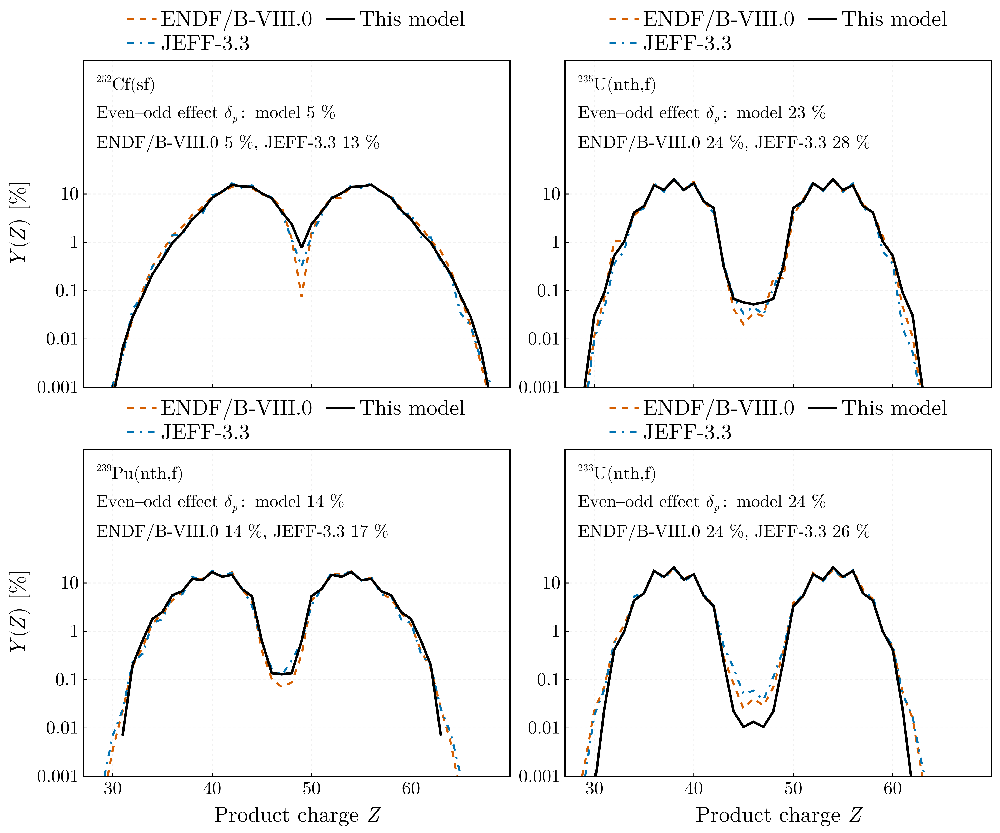

`Y(Z) = Σ_{A_p} Y(Z, A_p)`, on a logarithmic axis down to 0.001 %. Emission leaves the charge
alone, so the model's `Y(Z)` is the charge distribution of the solved configurations: the `Z_p`
model of Wahl, At. Data Nucl. Data Tables **39**, 1 (1988), doi:10.1016/0092-640X(88)90016-2,
with the reaction's own parameters, carried through the pre-neutron yield. Its even–odd
staggering is that model's proton factor `F_Z`, fitted to measured independent yields, and not a
result of the emission. Each panel states the global proton even–odd effect
`δ_p = (Y_e − Y_o)/(Y_e + Y_o)`, `Y_e` and `Y_o` the yields summed over the even and the odd
charges.

| System | `δ_p`: model / ENDF/B-VIII.0 / JEFF-3.3 | `Y(Z₀/2)` [%]: model / ENDF/B-VIII.0 / JEFF-3.3 |
|---|---|---|
| ²⁵²Cf(sf) | 5 / 5 / 13 % | 0.77 / 0.073 / 0.31 |
| ²³⁵U(n_th,f) | 23 / 24 / 28 % | 0.052 / 0.035 / 0.047 |
| ²³⁹Pu(n_th,f) | 14 / 14 / 17 % | 0.13 / 0.071 / 0.12 |
| ²³³U(n_th,f) | 24 / 24 / 26 % | 0.013 / 0.041 / 0.060 |

The model's `Y(Z)` is symmetric about `Z₀/2`, each split giving one light and one heavy charge,
and the evaluations nearly so. Over both humps the model lies with the two evaluations across
three decades. The valley is where it departs: for ²⁵²Cf the model gives the symmetric charge
`Z = 49` ten times the yield of ENDF/B-VIII.0, and for ²³³U a third of it.

## Isotopic distributions

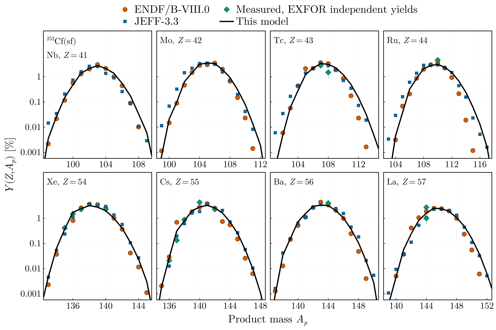
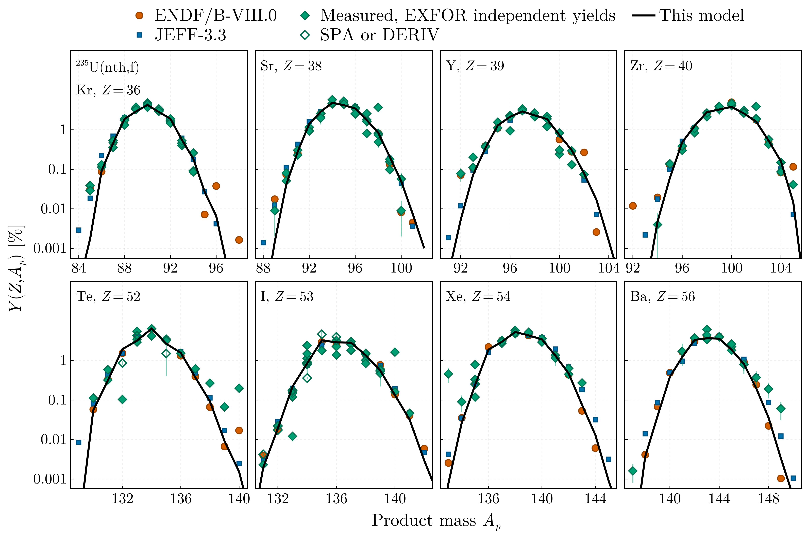
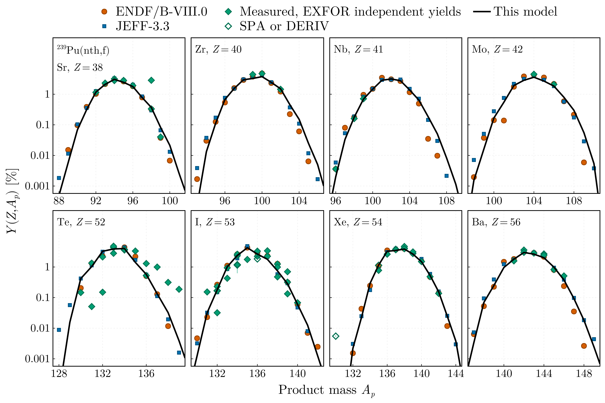
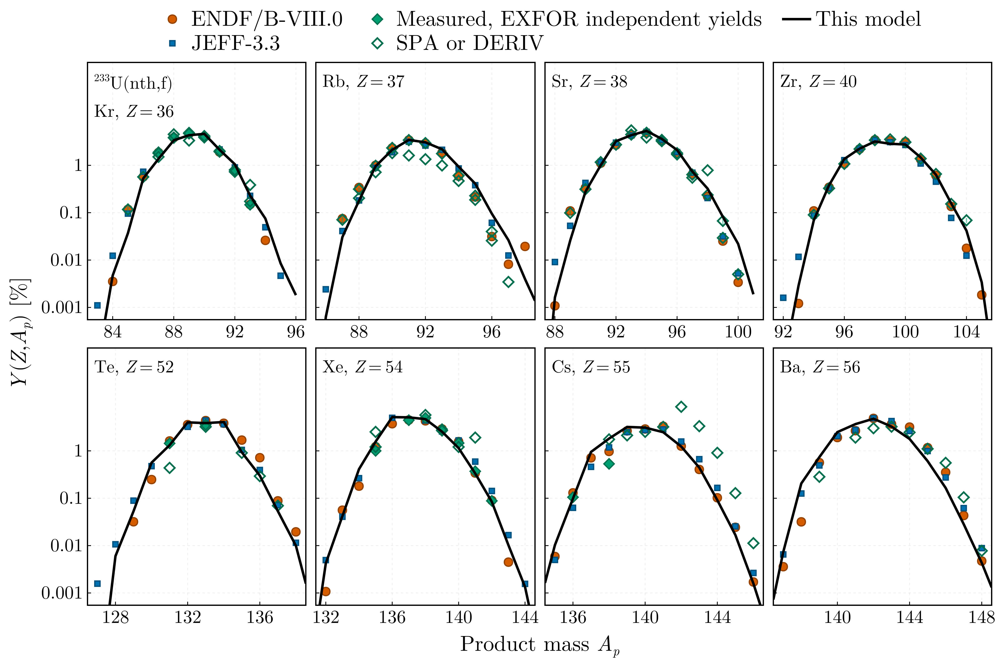

One figure per system. Each panel is `Y(Z, A_p)` at fixed `Z` against `A_p`, for the four light
and the four heavy elements of largest evaluated yield, the mean of the two libraries, so that
the choice does not move with the model. The model is the line, the
evaluations are markers: circles ENDF/B-VIII.0, squares JEFF-3.3. The model places the centroid
and the width of every distribution drawn and follows the evaluations over three decades. Its
distributions are smooth where the evaluations stagger from one isotope to the next: Wahl's
neutron factor `F_N` acts on the pre-neutron fragments, and emission, which moves each fragment
by its own number of neutrons, washes it out. The far wings, below 0.01 %, are where the two
libraries part from each other as well.

The diamonds are the measured independent yields of EXFOR, retrieved by ExforFissionData.jl
v0.5.0: every set coded `ELEM/MASS,IND,FY` with a point on the elements shown, pooled into one
family, open where the set is qualified `SPA` or `DERIV`, and converted to per cent from the
unit its record states, as for the mass yield. Yields below 0.001 % are not drawn. A nuclide the
archive reports in several isomeric states is drawn as the retrieval writes it: the archive's
own total where it gives one, otherwise the states summed. A nuclide reported in one state alone
carries that state's yield, not the nuclide's; its record names it under
`isomer_single_state_nuclides`. Of the sets retrieved, 6 of 8 have a point on the elements
shown for ²⁵²Cf, 26 of 48 for ²³⁵U, 14 of 23 for ²³⁹Pu and 8 of 17 for ²³³U. The ²³⁹Pu set
of Bogdzel (1991, 41179002) is not drawn: its record marks it superseded by Gundorin (1994,
41198002), a preliminary result the figure draws.

Where several sets measure one nuclide they mostly lie about the model and the evaluations. The
points far from both come from single sets, drawn as retrieved: among them the
tellurium yields of Günther (1972), digitised from a figure, which for ²³⁹Pu give 0.05 % at
`A_p = 131` against 1.1 to 1.3 % evaluated and 0.19 % at `A_p = 139` against 0.001 to
0.002 %, and the shielded ¹³⁰Xe of Fritze (1958), 0.0055 % for ²³⁹Pu against 4 × 10⁻⁷ to
3 × 10⁻⁶ % evaluated.

<details>
<summary>The measured sets of the isotopic distributions</summary>

The sets with a point on the elements drawn; `Code` as for the mass yield.

| System | Dataset | EXFOR | Code | Reference |
|---|---|---|---|---|
| ²⁵²Cf(sf) | von Gunten 1969 | 13353003 | IND | J. Inorg. Nucl. Chem. **31**, 3357 (1969) |
| ²⁵²Cf(sf) | Bugrov 1985 | 40895004 | IND | Vopr. At. Nauki Tekh., Ser. Yad. Konst. (1), 66 (1985) |
| ²⁵²Cf(sf) | Naik 1997 | 33028009 | IND | Nucl. Phys. A **612**, 143 (1997) |
| ²⁵²Cf(sf) | Reber 2005 | 14547005 | IND | J. Radioanal. Nucl. Chem. **264**, 243 (2005), doi:10.1007/s10967-005-0701-1 |
| ²⁵²Cf(sf) | Naik 2021 | 33158004, 33158005 | IND | Nucl. Sci. Eng. **195**, 717 (2021) |
| ²³⁵U(n_th,f) | Fröhner 1962 | 23792002 | IND, SPA | Z. Phys. **170**, 62 (1962) |
| ²³⁵U(n_th,f) | Strom 1966 | 13073003 | IND, SPA | Phys. Rev. **144**, 984 (1966), doi:10.1103/PhysRev.144.984 |
| ²³⁵U(n_th,f) | Delucchi 1970 | 13266002 | IND, SPA | Phys. Rev. C **1**, 1491 (1970), doi:10.1103/PhysRevC.1.1491 |
| ²³⁵U(n_th,f) | Ehrenberg 1972 | 30953004, 30953005 | IND | Phys. Rev. C **6**, 618 (1972) |
| ²³⁵U(n_th,f) | Günther 1972 | 23558007 | IND | Nucl. Phys. A **196**, 401 (1972) |
| ²³⁵U(n_th,f) | Venezia 1973 | 30964003 | IND | Thesis (1973) |
| ²³⁵U(n_th,f) | Brissot 1975 | 21550004, 21550008 | IND | Nucl. Phys. A **255**, 461 (1975) |
| ²³⁵U(n_th,f) | Imanishi 1976 | 20589003 | IND | Nucl. Phys. A **263**, 141 (1976) |
| ²³⁵U(n_th,f) | Strittmatter 1977 | 10722003 | IND | Trans. Am. Nucl. Soc. **27**, 862 (1977) |
| ²³⁵U(n_th,f) | Lang 1980 | 21689019 | IND | Nucl. Phys. A **345**, 34 (1980) |
| ²³⁵U(n_th,f) | Mariolopoulos 1981 | 21743002 | IND | Nucl. Phys. A **361**, 213 (1981) |
| ²³⁵U(n_th,f) | Shmid 1981 | 30960003, 30960005 | IND | J. Inorg. Nucl. Chem. **43**, 867 (1981) |
| ²³⁵U(n_th,f) | Hsu 1981 | 30666002I | IND | Phys. Rev. C **24**, 523 (1981) |
| ²³⁵U(n_th,f) | Fujiwara 1982 | 20848003, 20848006 | IND | J. Phys. Soc. Jpn. **51**, 1713 (1982) |
| ²³⁵U(n_th,f) | Engler 1983 | 30912003 | IND | Z. Phys. A **314**, 59 (1983) |
| ²³⁵U(n_th,f) | Rudstam 1990 | 221610021 | IND | Radiochim. Acta **49**, 155 (1990) |
| ²³⁵U(n_th,f) | Erten 1992 | 14641002 | IND, SPA | J. Radioanal. Nucl. Chem. Lett. **166**, 187 (1992) |
| ²³⁵U(n_th,f) | Naik 1993 | 33030005 | IND | Radiochim. Acta **62**, 1 (1993) |
| ²³⁵U(n_th,f) | Galy 1997 | 22488002 | IND | Conf. Nuclear Data for Science and Technology, Trieste 1997, vol. 1, p. 673 |
| ²³⁵U(n_th,f) | Tipnis 1998 | 13600002 | IND | Phys. Rev. C **58**, 905 (1998), doi:10.1103/PhysRevC.58.905 |
| ²³⁵U(n_th,f) | Naik 2023 | 33186004, 33186005 | IND, SPA | Nucl. Sci. Eng. **197**, 485 (2023) |
| ²³⁹Pu(n_th,f) | Fritze 1958 | 13484003 | IND, SPA | Conf. Peaceful Uses of Atomic Energy, Geneva 1958, vol. 15, p. 436 |
| ²³⁹Pu(n_th,f) | Günther 1972 | 23558006 | IND | Nucl. Phys. A **196**, 401 (1972) |
| ²³⁹Pu(n_th,f) | Imanishi 1976 | 20589004 | IND | Nucl. Phys. A **263**, 141 (1976) |
| ²³⁹Pu(n_th,f) | Brissot 1977 | 21549003, 21549007 | IND | Nucl. Phys. A **282**, 109 (1977) |
| ²³⁹Pu(n_th,f) | Kaiser 1978 | 21218006 | IND | J. Inorg. Nucl. Chem. **40**, 377 (1978) |
| ²³⁹Pu(n_th,f) | Fujiwara 1982 | 20848004, 20848007 | IND | J. Phys. Soc. Jpn. **51**, 1713 (1982) |
| ²³⁹Pu(n_th,f) | Naik 1993 | 33030007 | IND | Radiochim. Acta **62**, 1 (1993) |
| ²³⁹Pu(n_th,f) | Gundorin 1994 | 41198002 | IND, PRELM | Conf. Nuclear Data for Science and Technology, Gatlinburg 1994, p. 139 |
| ²³⁹Pu(n_th,f) | Bail 2009 | 22985008, 22985018 | IND | Thesis (2009); Phys. Rev. C **84**, 034605 (2011), doi:10.1103/PhysRevC.84.034605 |
| ²³⁹Pu(n_th,f) | Naik 2022 | 33178004, 33178005 | IND, SPA | Nucl. Sci. Eng. **196**, 824 (2022) |
| ²³³U(n_th,f) | Brissot 1975 | 21550005 | IND | Nucl. Phys. A **255**, 461 (1975) |
| ²³³U(n_th,f) | Flynn 1975 | 10517002 | IND | J. Inorg. Nucl. Chem. **37**, 869 (1975), doi:10.1016/0022-1902(75)80664-6 |
| ²³³U(n_th,f) | Imanishi 1976 | 20589002 | IND | Nucl. Phys. A **263**, 141 (1976) |
| ²³³U(n_th,f) | Wehring 1980 | 10918003 | IND, SPA | Trans. Am. Nucl. Soc. **35**, 551 (1980) |
| ²³³U(n_th,f) | Fujiwara 1982 | 20848005, 20848008 | IND | J. Phys. Soc. Jpn. **51**, 1713 (1982) |
| ²³³U(n_th,f) | Johansson 1997 | 23794002 | IND, SPA | Conf. Nuclear Data for Science and Technology, Trieste 1997, vol. 1, p. 652 |
| ²³³U(n_th,f) | Naik 2023 | 33187004 | IND, SPA | Nucl. Sci. Eng. **197**, 1133 (2023) |

</details>

## Neutron number distribution of the products

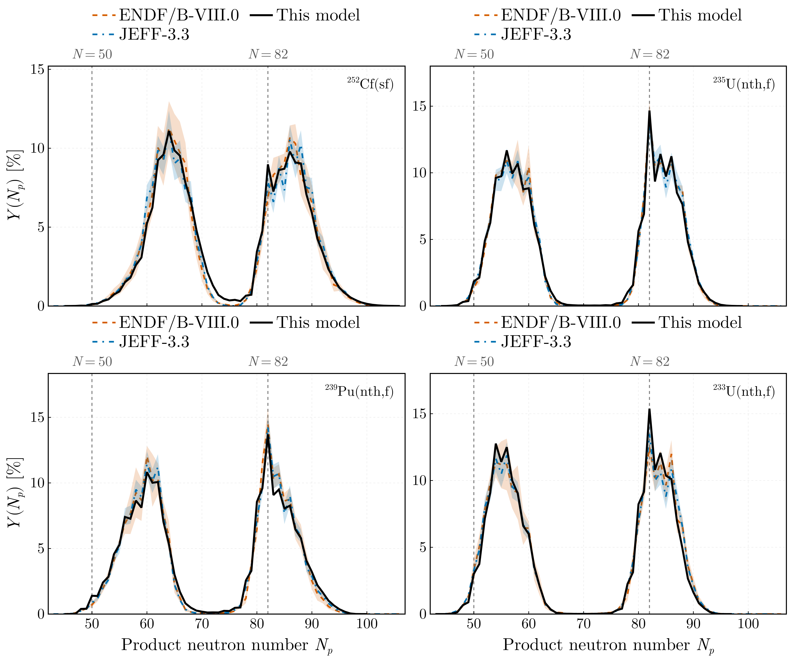

`Y(N_p) = Σ_{A_p − Z = N_p} Y(Z, A_p)`, the evaluations with their uncertainty as a band and the
closed shells `N = 50` and `82` as guides. The heavy products of the three thermal systems pile
up at `N_p = 82`: a heavy fragment just above the closure loses its weakly bound neutrons down to
it, and one at the closure barely emits. The model reproduces the peak for ²³⁵U and ²³⁹Pu and
overshoots it for ²³³U. ²⁵²Cf, whose heavy fragments lie further above the closure, has its heavy
hump at `N_p ≈ 86`, and there too the model puts too much yield on the closure itself.

| System | `Y(N_p = 82)` [%]: model / ENDF/B-VIII.0 / JEFF-3.3 | ⟨N_p⟩ light, heavy: model / ENDF/B-VIII.0 |
|---|---|---|
| ²⁵²Cf(sf) | 9.0 / 6.9 / 7.9 | 64.2, 86.4 / 63.6, 86.5 |
| ²³⁵U(n_th,f) | 14.7 / 14.4 / 13.6 | 56.9, 84.6 / 56.9, 84.7 |
| ²³⁹Pu(n_th,f) | 13.7 / 14.5 / 14.2 | 59.1, 84.2 / 59.1, 84.0 |
| ²³³U(n_th,f) | 15.5 / 12.5 / 13.5 | 55.7, 83.7 / 55.6, 84.0 |

## Kinetic energy of the products

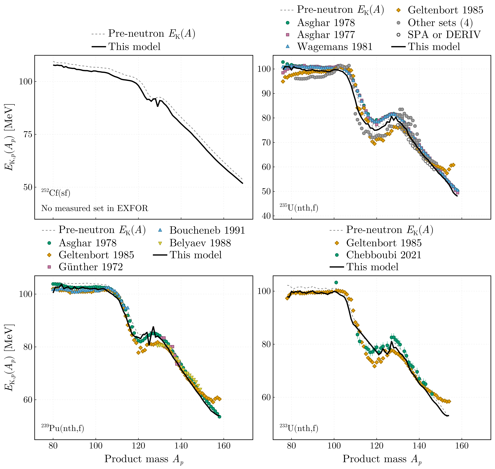

`E_K_p(A_p)`, the mean over the products of mass `A_p` of `E_K_p = E_K A_p/A`,
`E_K = TKE (A₀ − A)/A₀` being the kinetic energy of the fragment, beside the pre-neutron
`E_K(A)` of the yield the run was solved with as a dashed guide, against the fragment mass. That
guide is `⟨TKE⟩(A) (A₀ − A)/A₀`, `⟨TKE⟩(A)` read from the input the run's configuration names
and averaged with its complement as the run did. Emission isotropic in the fragment frame
leaves the velocity unchanged on average, so a product carries the fraction `A_p/A` of its
fragment's energy, and the curve is the guide moved down by 1 to 2 % and to lower mass by the
multiplicity. Masses whose product yield is below 0.01 % are not drawn.

The markers are the measured post-neutron kinetic energies of EXFOR, `MASS,SEC,KE`, retrieved
by ExforFissionData.jl v0.5.0 and drawn in MeV as the retrieval writes them, `unit_written =
"MEV"` in every record: nine sets for ²³⁵U, five for ²³⁹Pu and two for ²³³U. The archive holds
none for ²⁵²Cf(sf), and its panel says so. ²³⁵U has more sets than the figure can tell apart: the
four with the most masses, Asghar (1977, 1978), Wagemans (1981) and Geltenbort (1985), are
named, and Konecny (1970, two tables), Günther (1972), Bakhromi (1982) and Aleksandrov (1994)
are pooled into one grey series. Bakhromi is qualified `SPA` and drawn open. Averaged over the
masses each set covers, weighted by the model's product yield, the model lies 1.6 to 1.8 MeV
below the ²³⁵U sets of Asghar (1977, 1978) and Wagemans (1981) over the heavy products and 1.5 MeV
below Asghar's for ²³⁹Pu, while the three sets of Geltenbort (1985) lie between 0.5 MeV below the
model and 0.2 MeV above it: the sets that cover the whole heavy hump differ among themselves by as
much as the model differs from them. The sets covering part of it lie between 6.5 MeV above the
model and 1.6 MeV below it. Over the light products the model lies within the spread of the
sets, from 1.3 MeV below them to 1.7 MeV above.

<details>
<summary>The measured sets of the product kinetic energy</summary>

| System | Dataset | EXFOR | Code | Reference |
|---|---|---|---|---|
| ²³⁵U(n_th,f) | Konecny 1970 | 23551003, 23551004 | SEC | Z. Phys. **231**, 59 (1970) |
| ²³⁵U(n_th,f) | Günther 1972 | 235580032 | SEC | Nucl. Phys. A **196**, 401 (1972) |
| ²³⁵U(n_th,f) | Asghar 1977 | 21543017 | SEC | Nucl. Phys. A **292**, 225 (1977) |
| ²³⁵U(n_th,f) | Asghar 1978 | 21313014 | SEC | Nucl. Phys. A **311**, 413 (1978) |
| ²³⁵U(n_th,f) | Wagemans 1981 | 21752017 | SEC | Nucl. Phys. A **369**, 1 (1981) |
| ²³⁵U(n_th,f) | Bakhromi 1982 | 31797003 | SEC, SPA | Sov. J. Nucl. Phys. **36**, 788 (1982) |
| ²³⁵U(n_th,f) | Geltenbort 1985 | 21981015 | SEC | Conf. Nuclear Data for Basic and Applied Science, Santa Fe 1985, vol. 1, p. 393 |
| ²³⁵U(n_th,f) | Aleksandrov 1994 | 41496005 | SEC | Yad. Fiz. **57**, 2137 (1994) |
| ²³⁹Pu(n_th,f) | Günther 1972 | 235580022 | SEC | Nucl. Phys. A **196**, 401 (1972) |
| ²³⁹Pu(n_th,f) | Asghar 1978 | 21544009 | SEC | Nucl. Phys. A **311**, 205 (1978) |
| ²³⁹Pu(n_th,f) | Geltenbort 1985 | 21981016 | SEC | Conf. Nuclear Data for Basic and Applied Science, Santa Fe 1985, vol. 1, p. 393 |
| ²³⁹Pu(n_th,f) | Belyaev 1988 | 416930051 | SEC | Sov. J. Nucl. Phys. **48**, 204 (1988) |
| ²³⁹Pu(n_th,f) | Boucheneb 1991 | 23583003 | SEC | Nucl. Phys. A **535**, 77 (1991) |
| ²³³U(n_th,f) | Geltenbort 1985 | 21981014 | SEC | Conf. Nuclear Data for Basic and Applied Science, Santa Fe 1985, vol. 1, p. 393 |
| ²³³U(n_th,f) | Chebboubi 2021 | 23784003 | SEC | Eur. Phys. J. A **57**, 335 (2021), doi:10.1140/epja/s10050-021-00645-y |

</details>

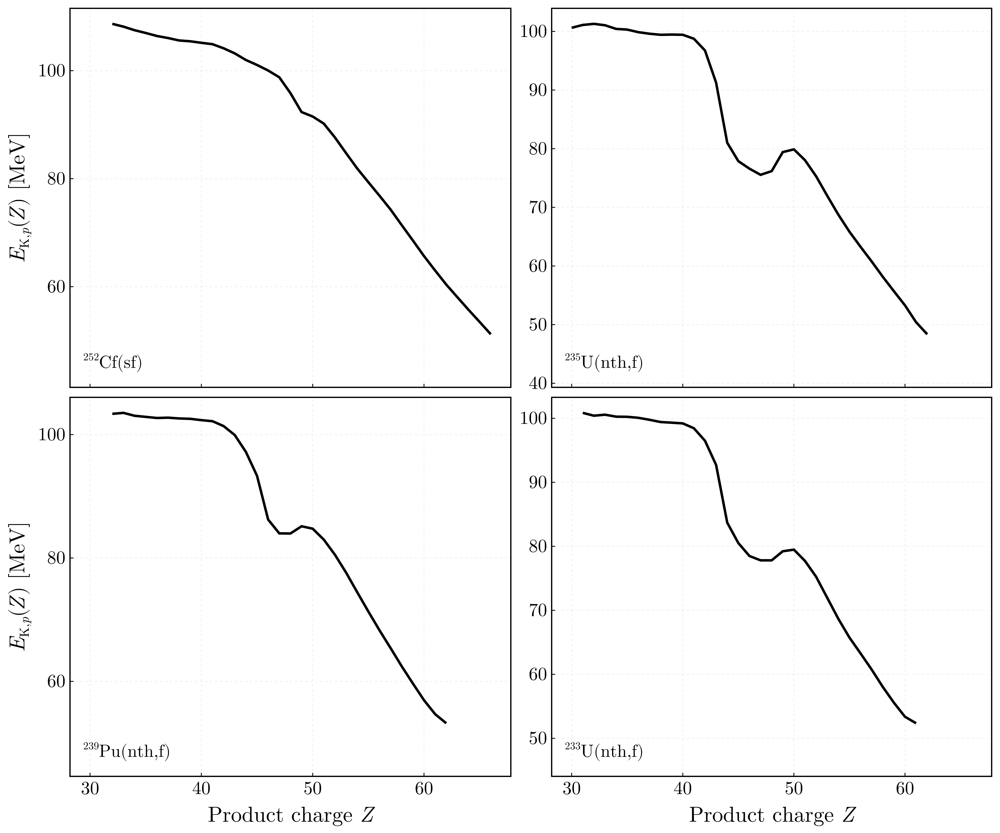

`E_K_p(Z)`, the same mean over the products of charge `Z`. It has no measured or evaluated
counterpart here.

## Total kinetic energy of the products

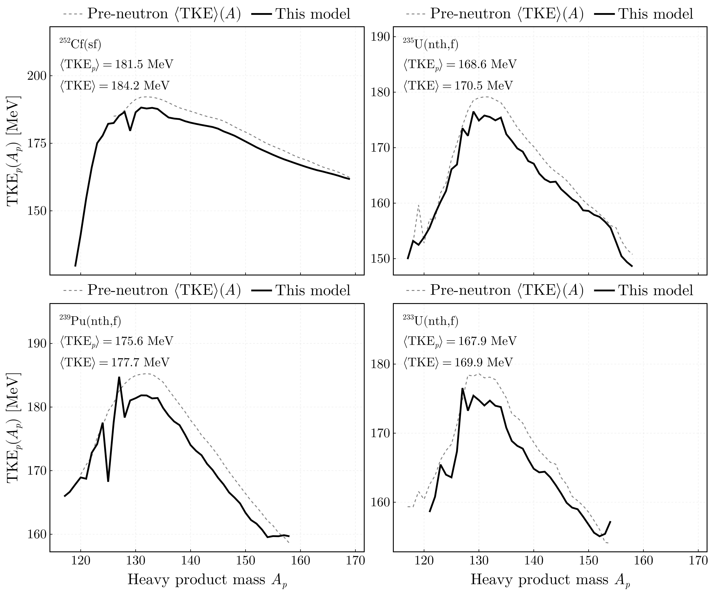

`TKE_p(A_p)`, the mean total kinetic energy of the two products against the heavy product mass,
with the pre-neutron `⟨TKE⟩(A)` input as a dashed guide against the heavy fragment mass. The
two products of a pair are taken as independent, so that `TKE_p` is the mean over both ends of
both chains. Masses whose heavy-product yield is below 0.01 % are not drawn. Each panel states
both means over the run: emission takes 1.9 to 2.6 MeV from the total kinetic energy.

| System | ⟨TKE⟩ [MeV] | ⟨TKE_p⟩ [MeV] |
|---|---|---|
| ²⁵²Cf(sf) | 184.2 | 181.5 |
| ²³⁵U(n_th,f) | 170.5 | 168.6 |
| ²³⁹Pu(n_th,f) | 177.7 | 175.6 |
| ²³³U(n_th,f) | 169.9 | 167.9 |

## Prompt γ energy

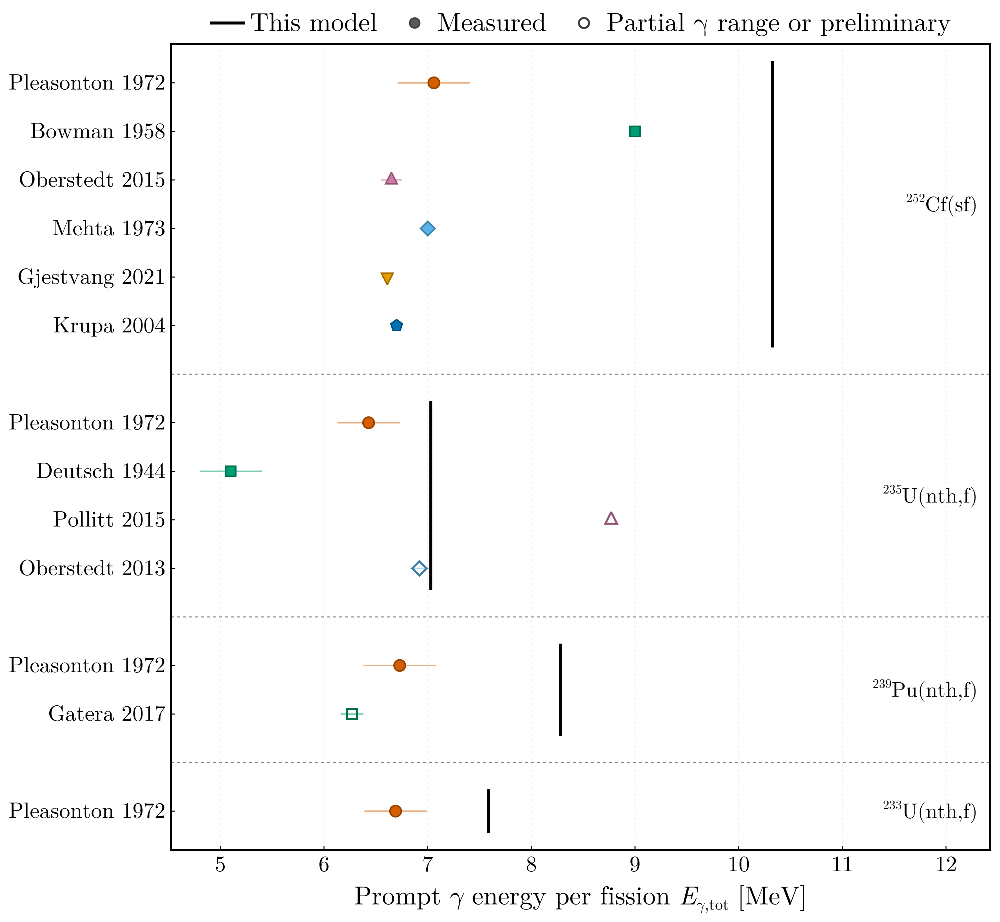

What the model's neutrons leave of the excitation, `E_γ = E* − Σ_k P(N ≥ k)(Sₙ^(k) + ⟨ε⟩_k)`
per fragment under the count `ν = (n+1)/2`, summed over the two fragments: 10.3, 7.0, 8.3 and
7.6 MeV per fission for ²⁵²Cf, ²³⁵U, ²³⁹Pu and ²³³U. It counts everything the neutrons do not
carry — γ rays, conversion electrons, X-rays, isomers — where a measurement counts γ rays above a
threshold within a time window, which its record states where the entry or its publication does;
the difference is about half an MeV. Against the measured values the model is high for ²⁵²Cf by
3.3 to 3.7 MeV and for ²³⁹Pu by 1.5 to 2.0; for ²³⁵U it lies 0.1 MeV above Oberstedt (2013) and
0.6 above Pleasonton (1972), for ²³³U 0.9 above Pleasonton. Open
markers are the sets the archive codes partial in γ energy (`PAR`) or marks preliminary. Left out:
Makii (2019), the γ energy between 1 and 6 MeV only, and the single detectors of Oberstedt (2015)
and Gatera (2017), whose averages are drawn; the sidecar names them.

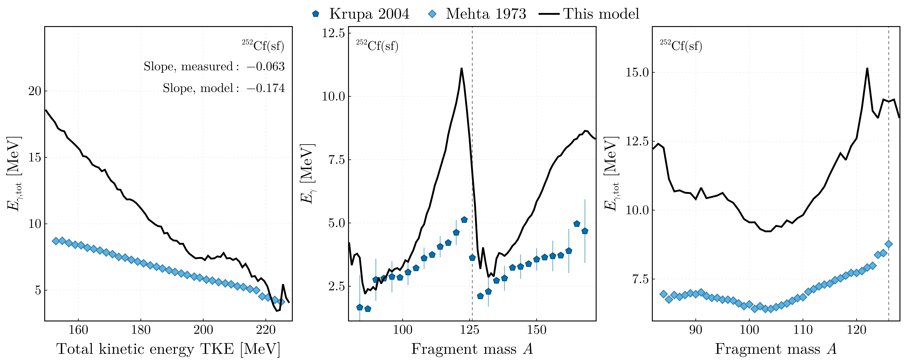

For ²⁵²Cf(sf) the archive holds the γ energy resolved: against TKE and against fragment mass, per
fission (Mehta 1973, binary fission), and of one fragment against its mass (Krupa 2004). Against
TKE the model falls almost three times as fast as the measurement, −0.17 against −0.063 MeV per
MeV of TKE: of an excitation added at fixed mass the measurement sends about one part in ten to
γ rays, the count `ν = (n+1)/2` three in ten. The same excess shapes `E_γ(A)`, highest
where `ν(A)` is, near symmetry and on the outer wings. It is the γ side of the multiplicity's
weak response to excitation that the main README records.

| System | Dataset | EXFOR | Reference |
|---|---|---|---|
| ²⁵²Cf(sf) | Pleasonton 1972 | 14214008 | ORNL-4844, p. 109 (1972); the method of Phys. Rev. C **6**, 1023 (1972), doi:10.1103/PhysRevC.6.1023 |
| | Bowman 1958 | 143870062 | Proc. 2nd UN Conf. Peaceful Uses of Atomic Energy, Geneva 1958, vol. 15, p. 212 |
| | Oberstedt 2015 | 231970093 | Phys. Rev. C **92**, 014618 (2015), doi:10.1103/PhysRevC.92.014618 |
| | Mehta 1973 | 232130061, 23213018, 23213010 | Phys. Rev. C **7**, 373 (1973), doi:10.1103/PhysRevC.7.373 |
| | Gjestvang 2021 | 237830041 | Phys. Rev. C **103**, 034609 (2021), doi:10.1103/PhysRevC.103.034609 |
| | Krupa 2004 | 23814004, 23814006 | Proc. Int. Symp. Exotic Nuclei, Peterhof 2004, p. 343 |
| ²³⁵U(n_th,f) | Pleasonton 1972 | 14214004 | Phys. Rev. C **6**, 1023 (1972), doi:10.1103/PhysRevC.6.1023 |
| | Deutsch 1944 | 14735002 | Los Alamos report LA-170 (1944) |
| | Pollitt 2015 | 232830023 | EPJ Web Conf. **93**, 02018 (2015), doi:10.1051/epjconf/20159302018, preliminary |
| | Oberstedt 2013 | 31729001 | Phys. Rev. C **87**, 051602 (2013), doi:10.1103/PhysRevC.87.051602 |
| ²³⁹Pu(n_th,f) | Pleasonton 1972 | 14214006 | Nucl. Phys. A **213**, 413 (1973), doi:10.1016/0375-9474(73)90161-9 |
| | Gatera 2017 | 31778005 | Phys. Rev. C **95**, 064609 (2017), doi:10.1103/PhysRevC.95.064609 |
| ²³³U(n_th,f) | Pleasonton 1972 | 14214002 | Nucl. Phys. A **213**, 413 (1973), doi:10.1016/0375-9474(73)90161-9 |

## Not drawn yet

The runs write more than the figures show, and the retrieval holds measurements the figures do
not yet use. Each of these enters this file with its figure and its dataset table when it is
ready.

- `ν(TKE)` and `E*(TKE)`, which the runs write as `nu_vs_TKE.dat` and `E_star_vs_TKE.dat`. The
  retrieval holds `ν(A, TKE)` as `nu_vs_A_TKE` for the four systems and `⟨ε⟩(A, TKE)` as
  `eps_vs_A_TKE` for ²⁵²Cf and ²³³U; a run writes neither.
- The prompt neutron multiplicity distribution `P(ν)`, against the retrieved `P_vs_nu` sets of
  the four systems; a run does not write it yet.
- The thermal systems' spectra as ratios to a Maxwellian, which the retrieval holds for all
  three.
